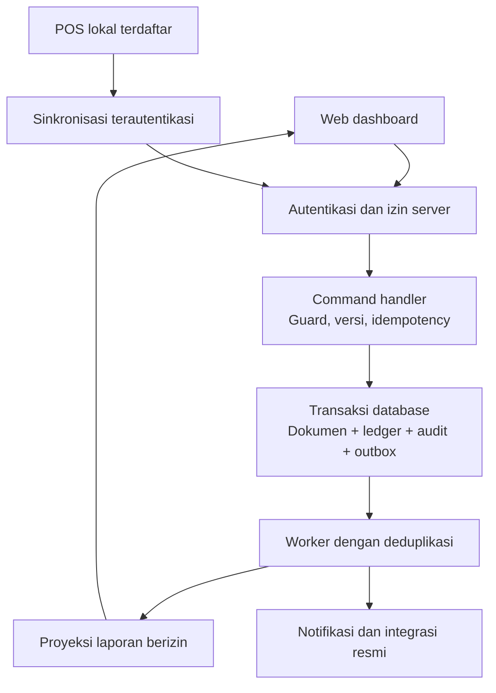
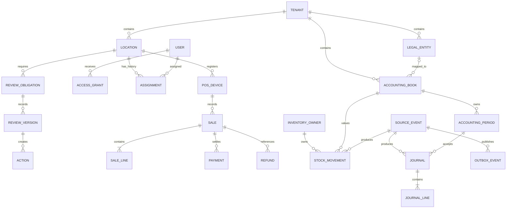

# ERP PT EBM d’Besto — Kontrak teknis v0.2

Tanggal: 1 November 2026. Status: rancangan normatif untuk review, belum kebijakan produksi yang disetujui dan belum kode aplikasi.

Induk: [Perencanaan v0.2](ERP-PT-EBM-Perencanaan-v0.2.md). Perhitungan bisnis: [KPI dan Akuntansi](ERP-EBM-v0.2-KPI-dan-Akuntansi.md).

## 1. Arti aturan dan batas kesiapan

Kata **wajib** pada dokumen ini berarti perilaku wajib bagi implementasi yang mengadopsi profil rancangan v0.2. Angka default adalah usulan desain, bukan keputusan bisnis pengguna. Kebijakan yang masih menunggu keputusan harus memiliki status `DRAFT` dan tidak dapat digunakan untuk transaksi produksi.

Dokumen ini menetapkan kontrak lintas modul dan contoh R1. Ini bukan OpenAPI lengkap, DDL final, atau klaim bahwa seluruh ERP siap coding. R2/R3 membutuhkan kontrak detailnya sendiri sebelum implementasi.

Urutan acuan: ketentuan pengguna terkonfirmasi → kebijakan bisnis yang disahkan dan berversi → lampiran KPI untuk angka → kontrak teknis ini untuk perilaku sistem. Konflik dicatat sebagai decision issue; developer tidak memilih interpretasi sendiri.

## 2. Batas arsitektur

Usulan: modular monolith dengan database transaksional bersama, batas domain tegas, antrean kerja, outbox, dan proyeksi baca. Setiap domain hanya memodifikasi tabel yang dimilikinya melalui command yang sah. Query lintas domain melalui layanan/reporting yang memiliki kontrol akses.

Tidak ada akses langsung browser/POS/AI ke database pusat. Sync ACK berarti penerimaan server telah durable; status posting dan rekonsiliasi tetap ditampilkan terpisah.

## 3. Identitas, izin, dan sesi

**AT01 — grant terikat scope.** Bentuk grant adalah `(user_id, role_id, action_set, legal_entity_scope, location_scope, valid_from, valid_to)`. Sebuah akses sah bila ada satu grant aktif yang mencakup action DAN semua scope resource itu. Jangan membentuk union semua action lalu mengalikannya dengan union semua scope.

Contoh: pengguna mempunyai `finance.view` di Resto A dan `review.submit` di Resto B. Ia tidak boleh mendapat `finance.view` di B atau `review.submit` di A. Seleksi peran di UI tidak menambah kewenangan. Delegasi memiliki pemberi, penerima, action, scope, masa berlaku, dan tidak boleh melebihi izin pemberi.

**AT02 — default deny.** Izin diperiksa server pada command, query, ekspor, unduhan lampiran, background export, dan AI retrieval. ID yang ditebak tetap tidak memberi akses. Scope wajib berasal dari resource yang ditemukan server, bukan hanya parameter klien.

**AT03 — akses kini vs atribusi historis.** Akses memakai grant saat permintaan terjadi. Laporan mempertahankan penanggung jawab historis. SPV yang pindah tidak otomatis berhak mengakses resto lama; kewajiban terbuka dapat dialihkan melalui command diaudit tanpa mengganti PIC historis.

**Profil autentikasi rancangan R1:**

| Parameter | Default usulan | Aturan |
|---|---|---|
| Identitas login | Username pegawai unik, case-insensitive | Akun individual; email terverifikasi untuk pemulihan bila tersedia |
| Pembuatan akun | Provisioning administrator setelah approval | Tidak ada signup publik |
| Sesi dashboard | Idle 30 menit; absolut 12 jam | Dihitung server; sesi kedaluwarsa wajib login ulang |
| Reautentikasi sensitif | Faktor login/MFA berusia maksimal 5 menit | Untuk perubahan akses, rekening, dan persetujuan pembayaran |
| Token reset | 15 menit, sekali pakai | Simpan hash token; pesan tidak membuka keberadaan akun |
| Pembatasan login | Setelah 5 kegagalan per akun dalam 15 menit, cooldown 15 menit | Tambahkan pembatasan IP/perangkat; jangan kunci permanen; audit dan jalur recovery |
| MFA | Admin dan approver sensitif | Recovery MFA memerlukan verifikasi identitas terpisah dan audit |

Angka profil harus disahkan pemilik keamanan sebelum produksi. Reset akun tanpa email hanya melalui prosedur verifikasi manusia yang disahkan; fitur itu nonaktif sampai prosedur tersedia.

Sesi web memakai cookie opaque `Secure`, `HttpOnly`, `SameSite=Lax`, rotasi setelah autentikasi/perubahan privilege, dan CSRF protection untuk perubahan state. Token tidak berada pada URL. Kata sandi di-hash adaptif dengan salt menggunakan pustaka terawat; parameter teknis dipin saat implementasi.

Logout mencabut sesi saat ini; reset kata sandi dan penonaktifan akun mencabut seluruh sesi pusat. Perubahan grant berlaku pada permintaan berikutnya. Sesi POS offline terpisah; pencabutan pusat tidak diklaim langsung mencapai perangkat yang terputus.

Prinsip default deny dan pengecekan tiap request mengikuti [OWASP Authorization Cheat Sheet](https://cheatsheetseries.owasp.org/cheatsheets/Authorization_Cheat_Sheet.html); pengelolaan cookie, expiry, dan pencabutan sesi mengikuti [OWASP Session Management Cheat Sheet](https://cheatsheetseries.owasp.org/cheatsheets/Session_Management_Cheat_Sheet.html). Nilai default di atas merupakan usulan proyek EBM.

## 4. Kamus field inti

| Field/objek | Tipe logis | Invariant |
|---|---|---|
| `id` | UUID | Stabil, tidak dipakai ulang; nomor dokumen terpisah |
| `tenant_id` | UUID | Batas organisasi platform; bukan pengganti legal entity |
| `legal_entity_id` | FK/null sesuai tipe buku | Mapping entitas wajib untuk buku LEGAL; buku MANAGEMENT yang belum dipetakan tidak dapat menghasilkan laporan resmi |
| `accounting_book_id` | FK | Buku MANAGEMENT/LEGAL terpisah dari lokasi; posting resmi memerlukan pemetaan entitas yang disahkan |
| `inventory_owner_id` | FK pihak | Pemilik barang, bukan otomatis operator lokasi atau pemilik saham |
| `location_id` | FK | Resto/gudang; tidak otomatis sama dengan entitas hukum |
| `business_date` | Date | Ditentukan kalender bisnis berversi, tidak dari tanggal UTC mentah |
| `occurred_at` | Timestamp UTC | Saat kejadian; berasal perangkat ditandai provenance |
| `received_at` | Timestamp UTC | Saat diterima server; tidak dapat ditulis klien |
| `posted_at` | Timestamp UTC/null | Waktu posting ledger; bukan tanggal kejadian |
| `posting_date` | Date/null sebelum posting | Tanggal buku; dapat berbeda dari tanggal server memproses. Lihat kontrak KPI |
| `period_id` | FK/null sebelum posting | Periode pembukuan yang menerima jurnal |
| `version` | Integer positif | Naik setiap mutasi; dibandingkan `expected_version` |
| `policy_version_id` | FK | Snapshot kebijakan yang menentukan hitungan/otorisasi bisnis |
| `source_event_id` | UUID | Identitas efek bisnis; unik per jenis efek ledger |
| `money` | Decimal(20,2), API string | Tidak memakai binary float; currency eksplisit |
| `quantity` | Decimal(18,6), API string | Satuan dasar; selaras dengan lampiran KPI |
| `unit_cost`, `inventory_value` | Decimal(24,8), API string | Presisi internal sebelum pembulatan jurnal; lampiran KPI menjadi acuan |
| `currency` | Kode mata uang | Profil R1 IDR; multicurrency tidak diasumsikan tersedia |
| `created_by`, `actor_id` | FK pengguna | Diambil sesi, bukan dipercaya dari body |
| `delegation_id` | FK/null | Wajib bila bertindak sebagai delegasi |
| `reason`, `evidence_ids` | Teks/referensi | Wajib untuk pengecualian, reversal, dan keputusan sesuai workflow |
| `review_obligation` | Resource | Unique `(tenant_id,resto_id,business_date,review_type)` |
| `ownership_version` | Resource | Masa berlaku tidak overlap pada lingkup hak yang sama |
| `idempotency_record` | Resource | Unique tenant + command type + key; payload hash dan response tersimpan |

Angka tabel merupakan kapasitas penyimpanan usulan, bukan izin membulatkan seluruh biaya ke dua desimal sebelum kalkulasi. Seluruh precision dan contoh rounding diselaraskan dengan lampiran KPI sebelum DDL final.

### ERD inti konseptual

ERD ini sengaja tidak menyatakan satu location selalu milik satu legal entity. Pemetaan legal owner/operator dan lingkup buku memiliki periode berlaku tersendiri. ERD/DDL per modul harus menambahkan foreign key, cardinality opsional, constraint, dan indeks yang diperlukan.

## 5. Kontrak command dan perubahan status

Setiap command: autentikasi → izin action+scope → validasi payload/kebijakan → idempotency → versi/state → lock yang diperlukan → transaksi atomik → response. Endpoint pembacaan tidak boleh mengubah state.

| Command | Actor | Guard dan transisi | Efek |
|---|---|---|---|
| `SaveReviewDraft` | Assignee berizin | NOT_STARTED/DRAFT; expected version cocok | DRAFT, tidak mengisi first_submitted_at |
| `SubmitReview` | SPV pemilik/delegasi | DRAFT atau CHANGES_REQUESTED; versi tepat; isi minimum dan jawaban perbaikan jika ada | SUBMITTED; versi immutable, first-submit hanya sekali, audit/outbox; resubmission label pada versi baru |
| `RequestReviewRevision` | ACM berizin | SUBMITTED; alasan wajib | CHANGES_REQUESTED; deadline dan timestamp awal tetap |
| `AcceptReview` | ACM berizin, bukan penyampai review | SUBMITTED versi terakhir | ACCEPTED; tidak menutup seluruh action otomatis |
| `CloseReview` | Sistem | ACCEPTED dan metadata wajib lengkap | CLOSED; tindakan terbuka tetap terpisah |
| `SaveReviewRevision` | Assignee berizin | CHANGES_REQUESTED; versi cocok | Simpan draft revisi; tidak mengubah first_submitted_at atau status menjadi accepted |
| `ReopenReviewForDataChange` | Service/ACM berizin | ACCEPTED/CLOSED dan snapshot baru berbeda | CHANGES_REQUESTED; acceptance lama tetap; versi baru perlu diperiksa |
| `VerifyAction` | Verifikator sah bukan PIC | Awaiting-verification; bukti/hasil ada | Verified; tidak menaikkan KR/KPI otomatis |
| `ReassignObligation` | Otoritas operasi | Penerima aktif, alasan, expected version | Assignee kini berubah; penanggung jawab historis tetap |
| `ApprovePO` | Approver sesuai policy | Submitted; limit dan pemisahan tugas valid | Approved pada versi yang ditandatangani |
| `PostReceipt` | Penerima barang | Approved PO, kuantitas/lot valid | Receipt posted, movement dan jurnal yang diwajibkan kebijakan |
| `DispatchTransfer` | Gudang asal | Approved, stok tersedia, batch sah | Kuantitas asal ke transit; tidak menjadi revenue internal |
| `ReceiveTransfer` | Gudang tujuan | Dispatch ada, sisa penerimaan cukup | Transit ke tujuan; selisih tetap terbuka |
| `CompleteSale` | Kasir/perangkat sah | Item/harga sah, fulfillment/pay policy valid | Sale final, efek stok/finance sesuai event kebijakan |
| `RequestRefund` | PIC/kasir berizin | Sale asal ada, batas refundable cukup | Refund requested; belum ada klaim uang sudah kembali |
| `PostSalesCreditNote` | Finance/service berizin setelah approval | Sale asal, saldo refundable, periode sah dan versi tepat | Kurangi revenue, bentuk refund payable/kurangi piutang; uang belum otomatis kembali |
| `ConfirmRefund` | Pelaksana/provider dengan bukti sesuai kanal | Credit note posted, kewajiban tersisa cukup, pembayaran terverifikasi | Selesaikan refund payable; tidak mengurangi revenue kedua kali atau otomatis menambah stok |
| `PostJournal` | Accounting/service berizin | Mapping sah, balance, periode open | Journal posted immutable dan audit |
| `ClosePeriod` | Finance checker | Rekonsiliasi lulus, exception resolved, lock sah | Closed dan snapshot final |

Status order, fulfillment, payment, sync, posting, dan data completeness adalah field berbeda. Tidak boleh digabung menjadi satu status “selesai”. Pembayaran digital pending tidak sama dengan lunas.

Review mempunyai `workflow_status`, `data_quality_status`, dan `timeliness_status`. `first_submitted_at < deadline_at` berarti tepat waktu; tepat pukul 12.00 terlambat. Waktu server menjadi dasar submit online. Revisi tidak mengubah timestamp awal. Review parsial tepat waktu tidak dihitung sebagai lengkap.

Approved document terikat `approved_version`; perubahan material membatalkan approval dan membutuhkan resubmit. Setelah posted, perubahan melalui reversal/koreksi dengan sumber, bukan update ledger. Maker tidak boleh menjadi checker jika policy mensyaratkan pemisahan.

## 6. Kontrak API minimum

Prefix `/api/v1`. ID resource tidak memberikan akses tanpa izin. Pagination berbasis cursor dan limit maksimum 100 pada profil rancangan. JSON monetary/quantity memakai string decimal. Format waktu ISO-8601 dengan offset/UTC; date terpisah.

| Endpoint | Request inti | Response |
|---|---|---|
| `POST /auth/login` | username, password; MFA challenge bila diperlukan | Sesi cookie atau challenge; tanpa membocorkan akun |
| `POST /auth/logout` | CSRF token | 204; sesi dicabut |
| `GET /me` | Sesi | Identitas dan grant/konteks yang diizinkan |
| `GET /review-obligations` | date, location, cursor | Data dalam scope, deadline, status, versi |
| `POST /reviews/{id}/submit` | expected_version, data_snapshot_id, findings, action_ids | resource_id, version, status, first_submitted_at |
| `POST /purchase-orders/{id}/approve` | expected_version, reason | Versi approval dan approver server |
| `POST /transfers/{id}/receive` | expected_version, line quantities, lot IDs, evidence | Receipt dan sisa kuantitas |
| `POST /pos/sync-batches` | device, lease, ordered events, device sequence | Per-event durable receipt dan status validasi/posting |
| `POST /periods/{id}/close` | expected_version, reconciliation_snapshot_id | Closed atau daftar blocking exception |

Contoh submit: `{"expected_version":3,"data_snapshot_id":"uuid","findings":"TC di bawah target","action_ids":["uuid"]}`. Header `Idempotency-Key` wajib untuk command mutasi; caller tidak mengirim `actor_id` sebagai otoritas.

Response sukses: `{"data":{"id":"uuid","version":4,"status":"SUBMITTED"},"meta":{"request_id":"uuid"}}`. Error: `{"error":{"code":"VERSION_CONFLICT","message":"Dokumen telah diperbarui","fields":[]},"request_id":"uuid"}`. Jangan mengirim stack trace, query, secret, atau data di luar scope.

| HTTP | Code | Makna |
|---|---|---|
| 400 | `INVALID_REQUEST` | Payload/schema tidak sah |
| 401 | `AUTH_REQUIRED` | Tidak ada sesi sah |
| 403 | `ACTION_FORBIDDEN` | Action tidak diizinkan; resource di luar scope dapat memakai 404 konsisten |
| 404 | `RESOURCE_NOT_FOUND` | Tidak ditemukan atau tidak boleh diungkap keberadaannya |
| 409 | `VERSION_CONFLICT`, `IDEMPOTENCY_CONFLICT`, `INVALID_STATE` | Konflik versi, key/payload, atau state |
| 422 | `POLICY_NOT_APPROVED`, `PERIOD_CLOSED`, `VALIDATION_FAILED` | Prasyarat bisnis belum terpenuhi |
| 429 | `RATE_LIMITED` | Pembatasan percobaan dengan retry guidance |
| 503 | `SERVICE_UNAVAILABLE` | Retry aman memakai key yang sama |

Key sama + hash payload sama mengembalikan hasil pertama, setelah izin caller diperiksa ulang. Key sama + payload berbeda → 409 tanpa mutasi. Pending command mengembalikan status yang sama; unique constraint menjadi pelindung race. Retensi response cache tidak boleh menghapus keunikan efek ledger permanen.

Versi berubah bersamaan: satu command commit, lainnya 409. Error sebelum commit tidak meninggalkan posting sebagian. Ketika client kehilangan response setelah commit, retry mengembalikan hasil commit tersebut.

## 7. POS offline dan perangkat

Offline adalah fitur dengan **production gate**: profil perangkat, penyimpanan tahan restart, key storage/enkripsi, printer, jam, kapasitas, durasi outage, dan prosedur pemulihan harus lulus uji. Jangan menjanjikan mode offline aman hanya karena aplikasi memakai browser/PWA.

Lease offline ditandatangani server dan mengikat user, device, lokasi, permission, policy/menu versions, issued_at, expires_at, serta batas operasi. Masa berlaku harus dikonfigurasi dan disetujui; nilai kosong menonaktifkan offline produksi. Demo dapat memakai 8 jam dengan label simulasi.

Default usulan R1 offline: transaksi tunai biasa pada perangkat terdaftar; tidak ada refund, perubahan harga, approval, reset akun, atau perubahan master. Pembayaran nonkas offline memerlukan kontrak provider dan gate tersendiri, tidak hanya bukti tangkapan layar.

Transaksi dan antrean lokal disimpan atomik. Envelope memuat `event_id`, `device_id`, `device_sequence`, `lease_id`, `occurred_at`, `business_date`, `payload_hash`, versi kebijakan, dan identitas transaksi. Server memverifikasi integritas serta urutan; gap sequence ditandai untuk rekonsiliasi.

Event tersimpan di server dengan receipt durable sebelum ACK. Status: `RECEIVED` → `VALIDATED` → `POSTED`, atau `EXCEPTION`. Event gagal lease/versi/periode tetap dipertahankan di exception store; tidak dibuang dan tidak otomatis dimasukkan ke pendapatan final. User melihat perbedaan antara tersimpan, diterima pusat, dan dibukukan.

Transaksi bisnis yang sudah terjadi tidak sama dengan izin posting akuntansi. Clock drift, lease kedaluwarsa, perangkat dicabut, atau stok kurang memerlukan investigasi dengan bukti; keputusan koreksi dicatat. Tidak ada rewrite harga/struk historis secara diam-diam.

Offline stock tidak dapat menjamin ketersediaan global banyak perangkat. Definisikan batas stok lokal/reservasi per perangkat atau prosedur exception sebelum pilot. Kegagalan server tidak boleh menduplikasi efek ketika perangkat retry.

## 8. Atomicity, ledger, outbox, dan close

Untuk satu accepted posting command dalam database inti, perubahan dokumen, stock movement, jurnal yang diwajibkan, audit, dan outbox dilakukan dalam satu transaksi. Bila jurnal belum dapat ditentukan, transaksi tetap status pending/exceptions sesuai kebijakan; jangan menyebutnya final hanya karena sale tersimpan.

Transport asynchronous diperlakukan at-least-once. Efek bisnis unik dijaga constraint `(tenant_id,source_event_id,effect_type,ledger_scope)`, bukan klaim pengiriman exactly-once. Worker menyimpan dedup receipt bersama hasilnya. Outbox tidak dihapus sebelum publikasi terkonfirmasi dan retensi terpenuhi.

Proyeksi dashboard dapat tertinggal; tampilkan watermark dan lokasi/perangkat yang belum lengkap. Data lengkap memerlukan seluruh sumber wajib selesai atau exception yang disetujui, bukan hanya waktu update terakhir satu perangkat.

Posting mengambil lock periode dan resource stok yang diperlukan dalam urutan tetap; close mengambil lock yang konflik pada periode yang sama. Di bawah lock, ulangi pemeriksaan status periode serta exception. Close tidak boleh bersaing dengan posting sehingga jurnal menyelinap setelah status closed.

Gunakan lock row/periode yang sesuai, timeout, dan retry transaksi untuk deadlock/serialization failure tanpa menggandakan command. Dukungan row lock dan potensi deadlock dijelaskan dalam [dokumentasi PostgreSQL Explicit Locking](https://www.postgresql.org/docs/current/explicit-locking.html); pemilihan query/lock mode diuji saat implementasi.

Late event ke periode closed masuk exception. Finance memilih reopen sah atau adjustment periode terbuka sesuai lampiran akuntansi. `occurred_at`, `business_date`, `posted_at`, dan periode jurnal tetap terpisah. Reopen menghasilkan revisi snapshot, tidak menghapus laporan final lama.

## 9. Acceptance teknis per rilis

| ID | Rilis | Kasus dan hasil wajib |
|---|---|---|
| T01 | R1 | Finance-view A + review-submit B tidak memberi finance-view B |
| T02 | R1 | Session expired/logout/deactivated ditolak pada API berikutnya |
| T03 | R1 | Reset token dipakai ulang/kedaluwarsa ditolak; password reset mencabut sesi |
| T04 | R1 | SPV pindah: atribusi lama tetap, akses sekarang mengikuti grant |
| T05 | R1 | Submit 11:59:59 tepat; 12:00:00 terlambat; revisi tidak menulis ulang waktu pertama |
| T06 | R1 | Retry sale identik 10 kali memberi satu efek sale/payment/stock/journal |
| T07 | R1 | Key sama dengan nominal berbeda ditolak tanpa efek kedua |
| T08 | R1 | Dua approve atas versi sama: satu sukses, satu version conflict |
| T09 | R1 | Crash sebelum commit tidak meninggalkan posting sebagian; crash sesudah commit aman diretry |
| T10 | R1 | Offline expiry/clock drift/sequence gap masuk exception yang dapat direkonsiliasi |
| T11 | R1 | Satu dari dua POS belum sync: resto belum lengkap |
| T12 | R1 | Close bersamaan posting tidak menerima jurnal sesudah closed tanpa prosedur reopen |
| T13 | R1 | Akses export dicabut sebelum download: download ditolak |
| T14 | R2 | Bagi hasil mengikuti versi saham, kebijakan dan approval; tidak menghambat R1 |
| T15 | Saat aktivasi AI | Retrieval, ekspor, cache, dan jawaban tidak melewati scope pengguna |

Semua test memakai fixtures angka dari lampiran KPI dan profil kebijakan yang disahkan untuk rilis tersebut. Toleransi, hardware, dan profil beban dinyatakan dalam hasil uji; angka desain bukan hasil pengukuran.

## 10. Definition of Ready per tiket modul

Sebelum coding modul bisnis: requirement ID dan rilis jelas; kebijakan/formula disahkan atau profil simulasi eksplisit; state transition actor/guard/side-effect lengkap; data dictionary + ERD + DDL migration draft tersedia; OpenAPI request/response/error/schema tersedia; scope matrix dan approval lengkap; fixtures/expected results tersedia; dependencies dan rollback terdefinisi.

OpenAPI dan DDL lengkap harus menjadi deliverable desain per tiket, bukan diasumsikan sudah tersedia dalam lampiran ini. Fondasi auth/schema dapat dirancang tanpa menebak keputusan keuangan; transaksi produksi yang bergantung pada kebijakan belum disahkan harus terblokir.

Setelah coding diizinkan pengguna, perubahan kontrak memerlukan version note dan pembaruan test terkait. Dokumen ini tidak memberi instruksi menjalankan implementasi sekarang.
