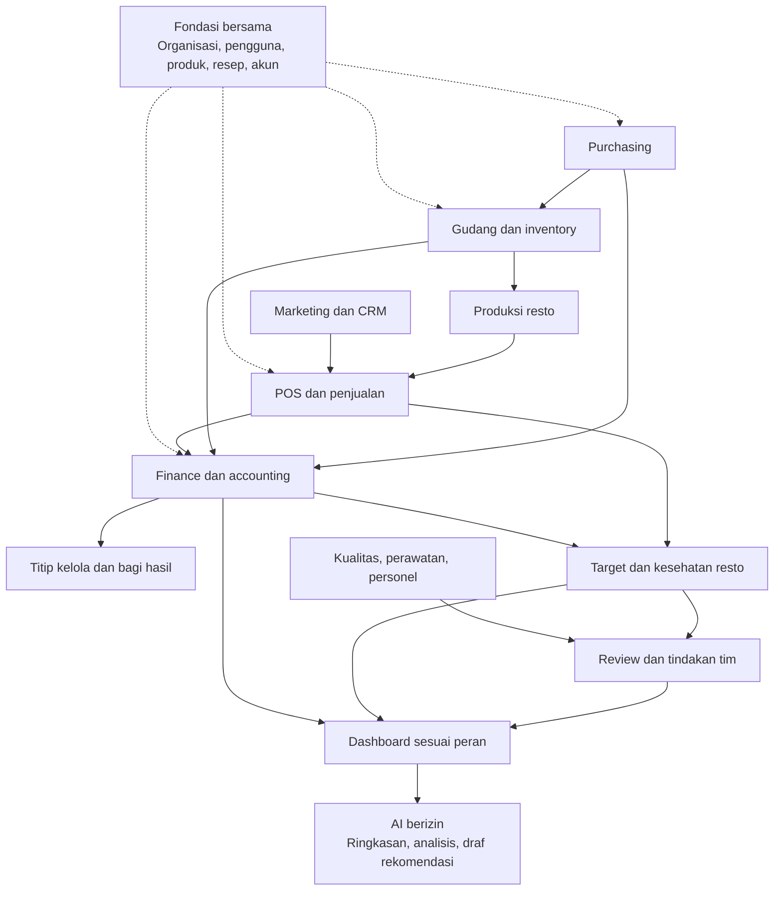
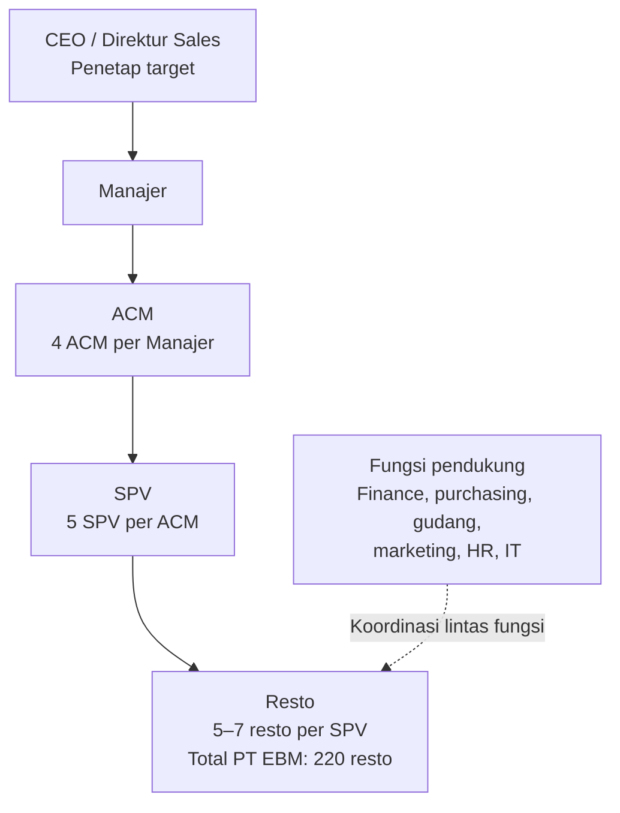
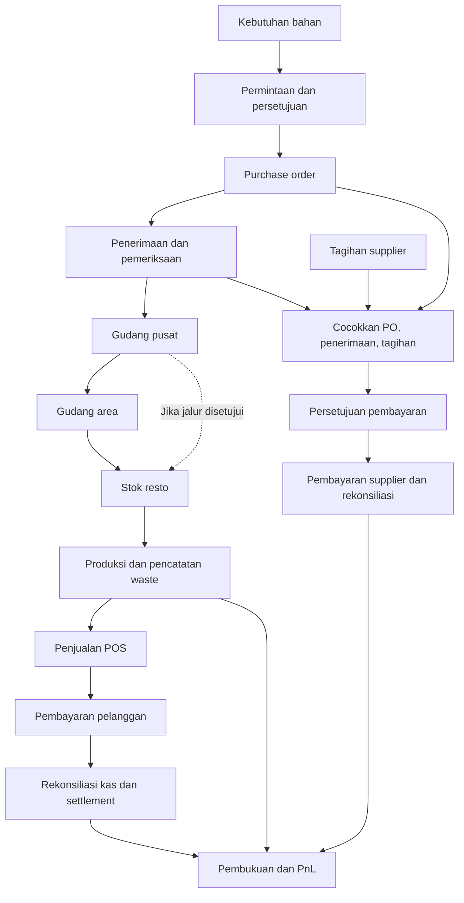
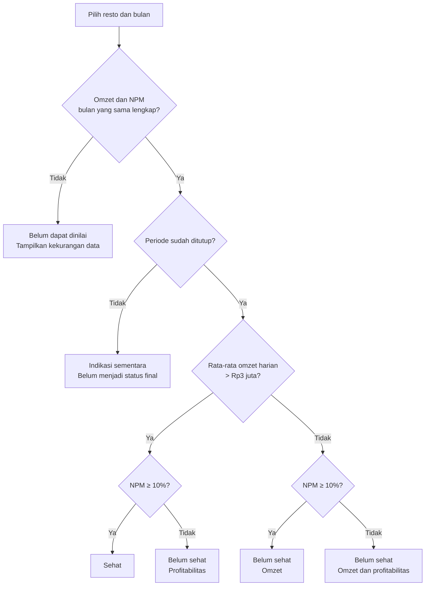
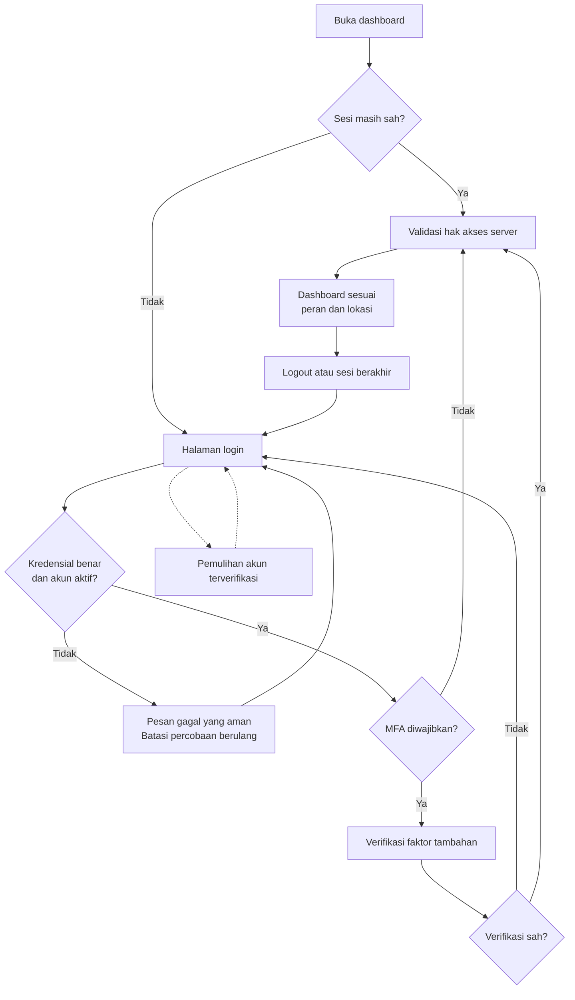
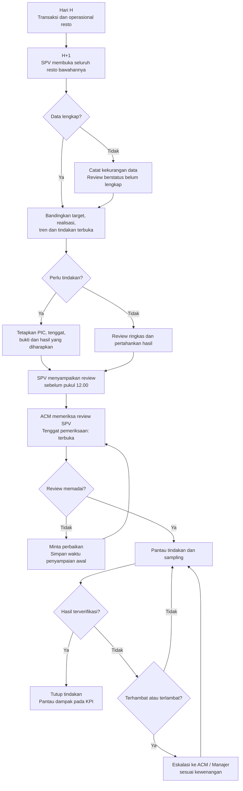
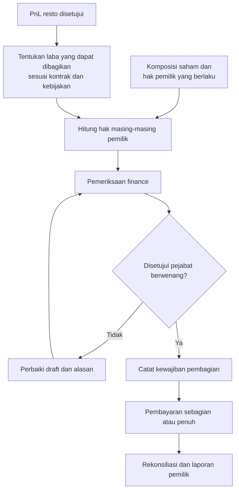
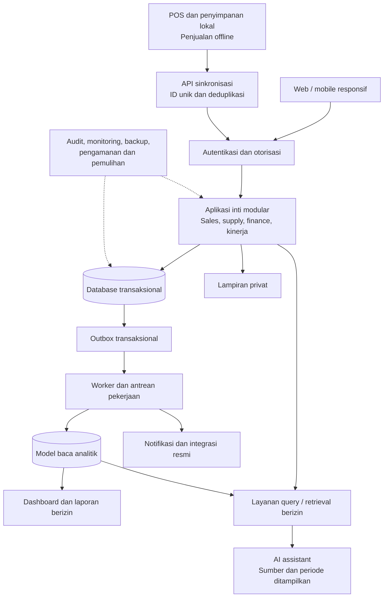
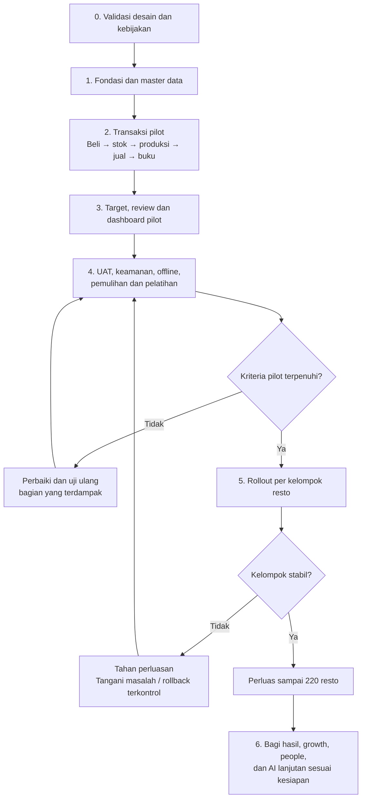

# Paket Perencanaan ERP PT EBM d’Besto

> **Arsip:** acuan desain terbaru adalah [v0.2](ERP-PT-EBM-Perencanaan-v0.2.md) beserta lampirannya. Dokumen v0.1 dipertahankan untuk histori dan tidak dipakai sebagai spesifikasi coding terbaru.

Versi: 0.1 — 1 November 2026  
Status: draft lengkap untuk review bisnis; belum disetujui untuk implementasi.  
Cakupan dokumen: BRD, PRD, FRD, TRD, roadmap, dan rencana penerimaan.  
Batas pekerjaan: perencanaan; tidak ada aplikasi, database, atau infrastruktur yang dibangun.  
Pembaruan visual: peta sistem, struktur tanggung jawab, login, alur barang dan uang, review, kesehatan resto, bagi hasil, arsitektur, dan roadmap.

## Cara membaca

- **Terkonfirmasi:** informasi atau keputusan yang diberikan pengguna.
- **Usulan:** rancangan standar yang dapat digunakan untuk pembahasan, belum merupakan kebijakan PT EBM.
- **Terbuka:** keputusan yang masih harus ditetapkan sebelum fungsi terkait dibangun atau dioperasikan.
- “Lengkap” berarti seluruh bagian perencanaan tercakup; bukan berarti semua asumsi telah memperoleh persetujuan.
- Dokumen ini mandiri dan menggantikan rangkaian draft percakapan sebagai acuan versi 0.1.
- Diagram berformat Mermaid. Buka dengan pembaca Markdown yang mendukung Mermaid agar tampil sebagai visual. Label **usulan** dan **terbuka** pada diagram memiliki arti yang sama dengan teks dokumen.

## Panduan baca cepat

| Jika ingin memahami… | Mulai dari |
|---|---|
| Gambaran seluruh ERP | Peta sistem di bawah, lalu A4 |
| Siapa bertanggung jawab | Struktur pada A1 dan peran pada B1 |
| Cara pengguna masuk | Alur login pada C2 |
| Barang dan uang mengalir | Alur operasional pada A4 |
| Rutinitas SPV dan ACM | Alur review pada C4 |
| Cara menilai resto sehat | Diagram keputusan pada C1 |
| Bagi hasil | Alur pada C9 |
| Cara sistem disusun | Diagram arsitektur pada D1 |
| Urutan pembangunan | Roadmap pada E1 |
| Hal yang belum diputuskan | Register G |

## Peta sistem ERP — rancangan usulan

Panah menggambarkan hubungan informasi utama. Satu sumber transaksi dapat digunakan beberapa modul tanpa diinput ulang.

# A. BRD — Kebutuhan bisnis

## A1. Profil dan ketentuan terkonfirmasi

| ID | Ketentuan |
|---|---|
| B01 | PT EBM mengelola seluruh 220 resto d’Besto dengan model titip kelola. |
| B02 | Terdapat gudang pusat dan gudang area. |
| B03 | Satu SPV membawahi 5–7 resto; satu ACM membawahi 5 SPV; satu Manajer membawahi 4 ACM. Jumlah personel aktual belum dikonfirmasi. |
| B04 | CEO sebagai Direktur Sales menetapkan target omzet berbeda sesuai kondisi masing-masing resto/area. |
| B05 | TC adalah jumlah struk, bukan jumlah pelanggan unik; target harian >100. |
| B06 | APC ditargetkan >Rp30.000; COGS bahan baku pembentuk produk jual ditargetkan <70%. |
| B07 | Resto sehat bila rata-rata omzet harian satu bulan >Rp3 juta dan NPM bulan yang sama ≥10%. |
| B08 | SPV mereview setiap resto pada H+1 sebelum pukul 12.00; intensitas mengikuti kondisi resto. |
| B09 | ACM memeriksa SPV bawahannya dan melakukan sampling langsung. Frekuensi dan tenggat review ACM belum ditetapkan. |
| B10 | PnL per resto tersedia dalam praktik bisnis, tetapi rancangan baru tidak bergantung pada sistem atau format lama. |
| B11 | Pembagian hasil mengikuti komposisi saham masing-masing resto. Dasar laba yang dibagikan belum ditetapkan. |
| B12 | Semua fungsi tim dapat menggunakan aplikasi dengan hak akses sesuai kebutuhan. |
| B13 | ERP dirancang dari awal; pengambilan informasi dari sistem lama tidak menjadi prasyarat penyusunan. |
| B14 | Pengguna wajib login sebelum masuk ke dashboard. Fitur login merupakan kebutuhan terkonfirmasi dan wajib tersedia pada R1. |

### Struktur tanggung jawab — terkonfirmasi

Diagram menunjukkan rasio pengawasan, bukan jumlah personel aktual. Fungsi pendukung belum memiliki garis pelaporan terkonfirmasi sehingga tidak ditempatkan sebagai bawahan tertentu.

## A2. Masalah dan tujuan

Masalah utama: target yang ditetapkan belum konsisten menjadi acuan kerja harian Manajer dan SPV. ERP harus menghubungkan target, transaksi, evaluasi, dan pertanggungjawaban.

| ID | Tujuan | Ukuran | Pemilik usulan |
|---|---|---|---|
| G01 | Disiplin menggunakan data | Review H+1 tepat waktu; kualitas review | Sales/Operasional |
| G02 | Memastikan masalah ditindaklanjuti | Tindakan selesai dan terverifikasi; umur eskalasi | SPV/ACM/Manajer |
| G03 | Meningkatkan kesehatan resto | Jumlah resto sehat; tren omzet dan NPM | CEO/Finance |
| G04 | Mengendalikan bahan dan stok | Selisih opname, waste, stockout, ketertelusuran | Supply chain/Operasional |
| G05 | Memastikan laporan dapat dipercaya | Rekonsiliasi, kelengkapan jurnal, penutupan | Finance |
| G06 | Menertibkan titip kelola | Ketepatan perhitungan dan pembayaran hak pemilik | Finance/Manajemen |
| G07 | Mengukur marketing | Anggaran, konversi terukur, repeat order, kontribusi campaign | Marketing |

Baseline dan target peningkatan ditetapkan saat pilot. Login atau membuka dashboard tidak cukup menjadi bukti penggunaan data. Hasil bisnis dipisahkan dari kepatuhan proses.

## A3. Batas bisnis dan kepemilikan

Usulan: resto menjadi lokasi operasional dan pusat pelaporan. Lokasi fisik, pusat biaya, entitas hukum, rekening, serta pihak pemilik dimodelkan terpisah. Status titip kelola tidak otomatis menentukan seluruh penjualan resto sebagai pendapatan hukum PT EBM.

Finance harus mengesahkan kebijakan pengakuan pendapatan, biaya pengelolaan, transaksi antarunit, alokasi biaya pusat, konsolidasi, pajak, dan distribusi laba. Sampai disahkan, laporan operasional 220 resto diberi label berbeda dari laporan keuangan resmi PT EBM.

## A4. Cakupan menyeluruh

1. Organisasi, identitas pengguna, kewenangan, dan master data.
2. POS, kanal penjualan, pembayaran, refund, dan tutup shift.
3. Resep, produksi, yield, pemakaian, dan waste.
4. Pengadaan, supplier, penerimaan, tagihan, dan pembayaran.
5. Gudang, distribusi, batch, expiry, opname, dan penyesuaian.
6. Accounting, kas/bank, utang-piutang, aset, anggaran, dan penutupan.
7. Titip kelola, komposisi saham, laporan pemilik, dan bagi hasil.
8. Target, kesehatan resto, review, sampling, tugas, KPI, dan OKR.
9. Audit operasional, kualitas, keluhan, perawatan, dan pelatihan.
10. Marketing, CRM, group order, loyalty, dan evaluasi campaign.
11. Personel, penempatan, jadwal, kehadiran; payroll sebagai subproyek tersendiri.
12. AI, analitik, notifikasi, integrasi, dan administrasi sistem.

Payroll lengkap, pelaporan pajak otomatis, koneksi platform delivery, payment gateway, dan kanal pemesanan pelanggan memerlukan discovery serta validasi khusus. Tidak diasumsikan tersedia pada rilis pertama.

### Alur barang dan uang — rancangan usulan

Distribusi dapat melalui gudang area atau jalur lain yang disetujui. Penerimaan barang dan pembayaran merupakan kejadian berbeda.

## A5. Risiko bisnis utama

| Risiko | Penanganan usulan |
|---|---|
| ERP terlalu luas dan sulit digunakan | Rancang menyeluruh, bangun bertahap, pilot alur lengkap |
| Kepatuhan hanya berupa pengisian form | Verifikasi bukti dan dampak tindakan; sampling ACM |
| Resep atau satuan salah | Persetujuan versi, uji transaksi, rekonsiliasi konsumsi |
| Laporan profit salah karena kebijakan belum jelas | Persetujuan finance sebelum aktivasi laporan resmi |
| Staf kesulitan beradaptasi | Pelatihan per peran, panduan kerja, superuser, dukungan pilot |
| Data awal tidak lengkap | Prosedur opname dan saldo awal bertanda persetujuan |
| Koneksi resto terganggu | POS offline, indikator sinkronisasi, prosedur pemulihan |

# B. PRD — Rancangan produk

## B1. Pengalaman inti

Beranda Saya menampilkan pekerjaan wajib, persetujuan, masalah, dan tenggat sesuai peran. Pengguna dapat menelusuri ringkasan sampai transaksi atau bukti yang diizinkan.

| Peran | Pekerjaan utama |
|---|---|
| CEO | Menetapkan target, melihat kesehatan jaringan, mengambil keputusan strategis |
| Manajer | Memeriksa ACM dan menangani hambatan lintas cluster |
| ACM | Memeriksa review SPV, menentukan sampling, memberi dukungan |
| SPV | Menyelesaikan review H+1 seluruh resto dan memverifikasi tindakan |
| PIC resto (usulan) | Menjalankan resto, kas, stok, checklist, dan tindak lanjut |
| Kasir | Penjualan, pembayaran, refund sesuai izin, pertanggungjawaban shift |
| Produksi | Produksi batch, hasil, waste, kebutuhan bahan |
| Gudang/Purchasing | Permintaan, pengadaan, penerimaan, transfer, opname |
| Finance | Rekonsiliasi, pembayaran, jurnal, tutup buku, bagi hasil |
| Marketing | Campaign, anggaran, CRM, group order, evaluasi |
| HR/Training | Penempatan, kompetensi, jadwal, kehadiran |

## B2. Prioritas rilis

| Rilis | Fitur | Batas |
|---|---|---|
| R1 — pilot operasional | Organisasi, master, POS, resep dasar, pembelian, stok, produksi, accounting dasar, target/review, tindakan | Satu alur lengkap pada cakupan terbatas; AI bukan penghambat kelulusan |
| R2 — pengendalian lanjutan | Bagi hasil, aset/perawatan, audit, marketing/CRM, HR dasar, OKR | Modul diaktifkan setelah kebijakan terkait disepakati |
| R3 — optimasi | Forecast, replenishment, evaluasi promo lanjutan, AI terkontrol | Perlu bukti kualitas data dan manfaat |

R1 membutuhkan subrilis internal dan uji menyeluruh; bukan satu kali pembangunan besar. Rollout ke 220 resto dipisahkan dari penyelesaian fitur pilot.

## B3. Kebutuhan dan penerimaan produk

| ID | Kebutuhan pengguna | Kriteria penerimaan ringkas |
|---|---|---|
| P01 | Melihat unit dan tanggung jawab | Riwayat penempatan tetap benar setelah perpindahan personel |
| P13 | Login dan masuk ke dashboard sesuai peran | Pengguna tanpa sesi aktif diarahkan ke login; akun aktif hanya dapat membuka dashboard dan data sesuai kewenangannya; logout mengakhiri sesi |
| P02 | Bertransaksi saat koneksi putus | Penjualan lokal tersimpan; sinkronisasi tidak menggandakan struk/jurnal |
| P03 | Mengetahui stok dan produksi | Pergerakan dapat ditelusuri; bahan tidak terpotong dua kali |
| P04 | Membeli dan menerima barang | Pesanan, penerimaan, retur, dan tagihan dapat dicocokkan |
| P05 | Melihat keuangan yang dapat diperiksa | Jurnal seimbang, periode terkontrol, sumber transaksi tersedia |
| P06 | Menyelesaikan review H+1 | Seluruh resto aktif tercakup; tepat waktu/terlambat/belum selesai terpisah |
| P07 | Mengawasi tindakan | PIC, tenggat, bukti, verifikator, dan eskalasi tersedia |
| P08 | Melihat kesehatan resto | Omzet dan NPM berasal dari bulan sama; data sementara ditandai |
| P09 | Menghitung hak pemilik | Versi saham dan dasar laba disetujui, hasil dapat direproduksi |
| P10 | Mengevaluasi marketing | Biaya dan hasil dipisahkan antara terukur, estimasi, dan belum diketahui |
| P11 | Mengelola kompetensi tim | Penempatan dan pelatihan dapat ditelusuri sesuai akses |
| P12 | Memakai AI dengan bukti | Jawaban mengikuti hak akses, sumber, periode, dan status data |

## B4. Pengalaman penggunaan

Usulan: POS menggunakan perangkat kasir; SPV/ACM/PIC mendapat tampilan mobile; pekerjaan administrasi mendukung desktop. Target perangkat, printer, pemindai, dan jaringan diverifikasi sebelum pengadaan.

Form memanfaatkan data yang sudah tersedia, meminimalkan input berulang, menampilkan validasi yang dapat ditindaklanjuti, serta tidak bergantung pada warna saja. Operasi offline di luar POS tidak diasumsikan tersedia pada R1.

# C. FRD — Kebutuhan fungsional

## C1. Kamus KPI

| ID | Ukuran | Rumus/aturan |
|---|---|---|
| K01 | Penjualan kotor | Jumlah nilai item sebelum diskon/retur; perlakuan pajak dikonfigurasi sesuai kebijakan |
| K02 | Penjualan bersih | Penjualan kotor − diskon penjualan − retur/refund yang relevan; basis pajak disahkan finance |
| K03 | TC | Jumlah struk penjualan sah, bukan orang unik. Usulan: batal dan refund-only tidak menambah TC; aturan refund penuh/parsial masih terbuka |
| K04 | APC | Basis omzet disepakati ÷ TC; bila TC nol, tampilkan tidak tersedia, bukan nol atau tak hingga |
| K05 | Pencapaian omzet | Realisasi ÷ target ×100%; target nol/kosong ditandai tidak dapat dihitung |
| K06 | Rata-rata omzet harian | Omzet satu bulan ÷ jumlah hari menurut kebijakan; hari kalender vs operasional belum diputuskan |
| K07 | COGS teoretis | Konsumsi standar resep atas penjualan × biaya sesuai metode penilaian; label estimasi |
| K08 | COGS aktual | Biaya bahan yang digunakan, dikoreksi produksi, waste, opname, dan persediaan relevan sesuai kebijakan finance; pembelian bukan otomatis pemakaian |
| K09 | COGS % | COGS ÷ basis penjualan disepakati ×100%; basis dan klasifikasi biaya konsisten |
| K10 | NPM | Laba bersih sesuai kebijakan PnL resto ÷ penjualan bersih ×100%; denominator nol ditandai tidak tersedia |
| K11 | Resto sehat | K06 >Rp3.000.000 DAN K10 ≥10% pada bulan sama; status final setelah penutupan |
| K12 | Review tepat waktu | Kewajiban review yang disampaikan sebelum batas ÷ seluruh kewajiban jatuh tempo; pengecualian tercatat |
| K13 | Penyelesaian tindakan | Tindakan terverifikasi tepat waktu ÷ tindakan jatuh tempo; pembatalan sah dilaporkan terpisah |

Agregasi rasio memakai total pembilang dan penyebut yang relevan, bukan rata-rata sederhana persentase. TC dari beberapa resto tidak dianggap pelanggan unik. Target >100 berarti 100 belum memenuhi; APC Rp30.000 tepat belum memenuhi; COGS 70% tepat belum memenuhi; NPM 10% tepat memenuhi. Batas Rp3 juta tepat belum memenuhi kesehatan omzet.

### Keputusan kesehatan resto — aturan terkonfirmasi

Status final membutuhkan data bulan yang sama dan penutupan. Jalur bulan berjalan hanya menghasilkan indikasi sementara. Dasar pembagi rata-rata harian masih terbuka.

## C2. Organisasi, akses, dan master — F01

### Alur login — wajib pada R1

Login wajib merupakan kebutuhan terkonfirmasi. Metode kredensial, pemulihan, dan detail sesi mengikuti usulan pada bagian ini.

- **Login wajib — terkonfirmasi:** dashboard, laporan, dan API bisnis memerlukan autentikasi. Halaman login dan pemulihan akun dapat diakses tanpa sesi.
- Alur: buka aplikasi → login → validasi akun aktif dan kredensial → MFA bila diwajibkan → dashboard sesuai peran dan cakupan lokasi. Jika memiliki beberapa peran, pengguna dapat memilih konteks yang memang diberikan kepadanya.
- Usulan metode R1: identitas akun unik (username atau email, ditetapkan sebelum implementasi) dan kata sandi. Akun disediakan administrator melalui proses persetujuan; pendaftaran publik tidak tersedia secara default.
- Sediakan logout, penggantian kata sandi, pemulihan akun terverifikasi, dan pemberitahuan sesi berakhir. Pemulihan tidak mengandalkan pertanyaan pribadi yang mudah ditebak; kanal verifikasi diputuskan sebelum implementasi.
- Akun nonaktif ditolak; pencabutan akses membatalkan sesi pusat. Perubahan izin berlaku pada permintaan berikutnya. Kebijakan akses POS offline diatur terpisah dan tidak memberikan akses dashboard pusat tanpa login.
- Pesan login/pemulihan tidak membocorkan keberadaan akun. Percobaan berulang dibatasi; login dan pemulihan penting dicatat tanpa menyimpan kredensial di log.
- Kode unik untuk lokasi, produk, bahan, supplier, personel, dan dokumen.
- Lokasi fisik, legal entity, pusat biaya, dan kepemilikan terpisah.
- Penempatan dan delegasi bertanggal mulai/akhir; delegasi kedaluwarsa otomatis.
- Satuan dasar dan konversi eksplisit; kuantitas dan biaya tidak memakai bilangan pecahan biner untuk perhitungan finansial.
- Resep, harga, pajak, target, dan saham memiliki versi, status draft/disetujui/berlaku/nonaktif.
- Record yang sudah dipakai tidak dihapus; dinonaktifkan dengan riwayat.

## C3. Target dan kesehatan — F02

Alur: draft → diajukan → disetujui CEO → berlaku → berakhir/digantikan.

- Sistem mendukung target harian per resto dan rencana bulanan; metode pembagian bulanan belum diputuskan.
- Total target bawahan membentuk target agregat; revisi tidak menimpa versi sebelumnya.
- Perubahan berlaku surut ditolak secara default; pengecualian memerlukan alasan dan persetujuan khusus.
- Pencapaian target terpisah dari ambang kesehatan.
- Bulan berjalan berupa indikasi; tidak memakai NPM bulan lalu seolah NPM bulan ini.
- Data belum lengkap menghasilkan status tidak dapat dinilai, dengan rincian yang hilang.

## C4. Review, tindakan, sampling, dan OKR — F03

Kewajiban review dibentuk untuk setiap resto aktif pada hari usaha terkait. Tenggat adalah H+1 sebelum 12.00 menurut zona bisnis yang dikonfigurasi. Untuk draft ini Asia/Bangkok digunakan sebagai asumsi perencanaan; zona tiap lokasi dan definisi hari usaha harus disahkan sebelum implementasi.

Status review: belum mulai → draft → disampaikan → diperiksa ACM → ditutup; ACM dapat meminta perbaikan. Timestamp penyampaian pertama dan versi perbaikan disimpan terpisah; revisi tidak menghapus fakta keterlambatan.

Isi minimum: periode, KPI dan status data, masalah/hasil, bukti, tindakan jika diperlukan. Review sehat dapat ringkas. Review bermasalah memerlukan diagnosis atau rencana pemeriksaan. SPV boleh menyampaikan review dengan data belum lengkap, tetapi status itu terlihat terpisah dari review lengkap.

Status tindakan: terbuka → dikerjakan → menunggu verifikasi → selesai terverifikasi; alternatif terhambat, dibuka kembali, dibatalkan dengan alasan. Satu PIC utama; tenggat; verifikator; bukti; ketergantungan. PIC tidak otomatis memverifikasi pekerjaannya sendiri.

Usulan eskalasi: SPV → ACM → Manajer; masalah keselamatan pangan/keuangan mendesak dapat langsung melewati jalur biasa. Jeda eskalasi, penerima, dan jam tenang masih terbuka. Notifikasi tidak menggantikan status di aplikasi.

Sampling usulan: dua resto per ACM per minggu, satu berbasis risiko dan satu rotasi. Sistem mencatat alasan, jadwal, pemeriksaan lapangan, bukti, dan tindak lanjut; mendeteksi lokasi yang lama tidak disampling. Frekuensi final mengikuti kapasitas aktual.

OKR memiliki objective, periode, pemilik, KR dengan baseline/target/sumber, check-in, dan inisiatif. Tugas selesai tidak otomatis menaikkan pencapaian KR. Formula scoring disetujui sebelum dipakai untuk evaluasi personel.

### Alur review H+1 dan tindak lanjut

Review seluruh resto dan tenggat SPV terkonfirmasi. Mekanisme verifikasi, eskalasi, serta penjadwalan sampling merupakan rancangan usulan; tenggat ACM masih terbuka.

## C5. POS dan pembayaran — F04

Shift: belum dibuka → aktif → hitung kas → diajukan → diverifikasi/selisih → ditutup.

Penjualan memisahkan status pesanan, pembayaran, dan pembukuan. Usulan pesanan: draft → dikonfirmasi → dipenuhi/selesai; batal tetap disimpan. Pembayaran: belum dibayar/sebagian/lunas/refund sebagian/refund penuh. Pembayaran gagal tidak diperlakukan sebagai penerimaan.

- Diskon, void, refund, dan buka kembali shift memerlukan kewenangan.
- Refund mengacu transaksi asal, metode, alasan, jumlah, approver, dan status penyelesaian.
- Rekonsiliasi membedakan penjualan bruto, komisi, subsidi, biaya, dan settlement neto per kanal.
- Transaksi offline menggunakan ID unik; bukti pembayaran eksternal tidak diklaim terverifikasi tanpa konfirmasi penyedia.
- Struk belum tersinkronisasi terlihat; sinkronisasi dapat dicoba ulang tanpa duplikasi.
- Harga/resep offline menggunakan versi tersimpan; konflik tidak boleh diam-diam menulis ulang transaksi yang sudah terjadi.

## C6. Produksi, inventory, distribusi — F05

- Model stok mendukung bahan mentah, bahan antara, dan produk jadi bila dibutuhkan proses.
- Produksi: draft → dirilis → bahan dikeluarkan → hasil dicatat → selesai → diverifikasi. Yield dan waste tersimpan.
- Strategi pengurangan dipilih per item: bahan ke produksi lalu produk jadi ke penjualan, atau backflush resep langsung dari penjualan; tidak keduanya untuk bahan yang sama.
- Stok: saldo awal + penerimaan + transfer masuk + hasil produksi − pemakaian − penjualan item stok − transfer keluar − waste ± penyesuaian.
- Kuantitas tersedia, reservasi, karantina, dan dalam perjalanan dipisahkan.
- Transfer: diminta → disetujui → disiapkan → dikirim → diterima sebagian/penuh → selisih diselesaikan → ditutup.
- Batch/expiry wajib untuk item yang ditetapkan; usulan rekomendasi pengambilan FEFO. Barang karantina/kedaluwarsa diblokir dari pemakaian normal.
- Opname: jadwal → hitung → investigasi → persetujuan → posting penyesuaian. Usulan blind count dan recount untuk selisih material.
- Stok negatif diblokir secara default pada gudang; kebijakan pengecualian POS offline dan pencatatan terlambat perlu disahkan.
- Valuasi FIFO atau rata-rata tertimbang dipilih finance; FEFO fisik tidak otomatis menentukan metode valuasi akuntansi.

## C7. Purchasing dan supplier — F06

Permintaan → persetujuan → PO → penerimaan → pencocokan tagihan → pembayaran → tutup.

- Mendukung penerimaan/tagihan/pembayaran sebagian, retur, dan credit note.
- Cek duplikasi nomor tagihan per supplier dan entitas.
- Pencocokan tiga dokumen: PO, penerimaan, tagihan; toleransi harga/kuantitas dikonfigurasi.
- Penerima barang tidak otomatis menyetujui pembayaran.
- Perubahan rekening supplier memerlukan pemeriksaan pihak kedua dan riwayat.
- Pengadaan darurat memiliki jalur khusus dengan alasan dan review setelah kejadian.

## C8. Accounting, kas, aset, penutupan — F07

- Setiap posting mempunyai entitas, periode, akun, pusat biaya/lokasi, debit/kredit, sumber, dan ID unik.
- Jurnal harus seimbang; transaksi operasional dan posting dihubungkan dengan status pending/posted/failed/reversed.
- Reversal dan jurnal koreksi menggantikan penghapusan jurnal posted.
- Pembayaran dipisahkan dari persetujuan tagihan; pencatatan pembayaran tidak otomatis berarti bank telah menyelesaikan transaksi.
- Kas kecil memakai pertanggungjawaban dan replenishment; pengeluaran membutuhkan kategori dan bukti sesuai kebijakan.
- Aset: perolehan, lokasi/PIC, penyusutan, mutasi, perawatan, pelepasan; metode disahkan finance.
- Penutupan: rekonsiliasi → inventori/COGS → akrual/penyesuaian → alokasi → review PnL → persetujuan → kunci periode.
- Checklist mencakup kas/bank, settlement, utang-piutang, stok, aset, dan transaksi belum diposting.
- Membuka periode kembali membutuhkan alasan, approver, dan revisi laporan; snapshot lama dipertahankan.
- Transaksi antarunit yang hanya perpindahan internal tidak otomatis menjadi pendapatan eksternal; eliminasi mengikuti kebijakan entitas.

## C9. Titip kelola dan bagi hasil — F08

### Alur bagi hasil — usulan, menunggu kebijakan kontrak dan finance

Komposisi saham sebagai dasar pembagian sudah terkonfirmasi. Besaran laba yang dapat dibagikan, perubahan saham tengah periode, dan kewenangan persetujuan belum ditetapkan.

- Master pemilik, perjanjian, rekening terverifikasi, dan kepemilikan bertanggal berlaku.
- Total komposisi pada lingkup hak yang sama harus 100%; pemisahan saham dan hak kontraktual dimodelkan bila berbeda.
- Dasar pembagian: laba disetujui ± penyesuaian kontraktual − cadangan/kerugian yang berlaku; seluruh komponen dapat diperiksa.
- Alur: draft → diperiksa → disetujui → kewajiban dicatat → dibayar sebagian/penuh → direkonsiliasi.
- Perubahan saham tengah periode mengikuti aturan kontrak yang disahkan; tidak diasumsikan selalu prorata hari.
- Pemilik hanya melihat informasi yang diizinkan; akses portal pemilik adalah fitur lanjutan.
- Pembagian laba dan biaya pengelolaan tidak dicampur tanpa kebijakan akuntansi yang jelas.

## C10. Marketing, CRM, group order — F09

- Campaign: tujuan, segmen/lokasi, periode, anggaran, biaya aktual, kanal, materi, persetujuan, hasil.
- Voucher: aturan eligibility, masa berlaku, batas penggunaan, pendanaan diskon, dan kaitan struk.
- CRM: identitas pelanggan dengan persetujuan penggunaan data, preferensi kontak, deduplikasi, dan permintaan penghentian kontak.
- Tidak mengasumsikan identitas pelanggan tersedia dari seluruh kanal.
- Views/impressions dibedakan dari leads, transaksi, pendapatan, dan kontribusi. ROAS hanya jika biaya dan atribusi tersedia; estimasi diberi label.
- Group order: lead → penawaran → konfirmasi → deposit → pemenuhan → pelunasan → evaluasi.
- Konversi campaign tidak diklaim sebagai dampak tambahan kausal tanpa rancangan evaluasi yang memadai.

## C11. Tim, kualitas, perawatan — F10

- Data personel minimum, penempatan, jadwal, kehadiran, pelatihan, sertifikasi, dan masa berlaku.
- Checklist buka/tutup, kebersihan, penyimpanan, kualitas produk, serta pencatatan pemeriksaan sesuai SOP yang disahkan.
- Temuan berisiko tinggi memicu insiden, pembatasan penggunaan item/lokasi bila berwenang, dan eskalasi.
- Keluhan pelanggan terhubung dengan resto/transaksi jika diketahui, kategori, SLA usulan, tindakan, dan penyelesaian.
- Perawatan memiliki aset, prioritas, vendor, biaya, jadwal, bukti, dan status.
- Payroll dan formula kewajiban tenaga kerja dirancang terpisah setelah kebijakan dan ketentuan yang berlaku diverifikasi.

## C12. AI — F11

- Read-only lebih dahulu; sumber terstruktur dan SOP yang disetujui.
- Jawaban menyertakan periode, waktu pembaruan, sumber, serta batas data; menolak menyimpulkan angka yang tidak tersedia.
- AI memakai izin pengguna sampai tingkat lokasi dan field, termasuk lampiran dan dokumen retrieval.
- Draf tindakan memerlukan persetujuan sebelum dibuat aktif; pembayaran/jurnal/perubahan stok tidak dijalankan mandiri.
- Dokumen, pesan, dan hasil retrieval diperlakukan sebagai data, bukan instruksi sistem.
- Evaluasi mencakup ketepatan angka, kebocoran akses, halusinasi sumber, dan manfaat pengguna.
- Forecast diuji terhadap baseline sederhana dan data holdout; metrik dipilih sesuai pola permintaan, termasuk hari dengan penjualan nol.

## C13. Matriks persetujuan usulan

| Aktivitas | Pengaju/pelaksana | Pemeriksa/approver | Kontrol |
|---|---|---|---|
| Target | Tim Sales | CEO | Versi dan tanggal berlaku |
| Review H+1 | SPV | ACM | Timestamp dan permintaan perbaikan |
| Tindakan resto | PIC | SPV/verifikator | Bukti, konflik kepentingan |
| PO | Purchasing | Pemegang kewenangan anggaran | Batas nominal belum ditetapkan |
| Penerimaan | Gudang/PIC | Pemeriksa sesuai selisih | Cocokkan PO dan fisik |
| Bayar supplier | Finance maker | Finance checker/pejabat berwenang | Tagihan, rekening, batas nominal |
| Koreksi stok | Gudang/PIC | SPV/otoritas inventory/finance | Nilai dan alasan menentukan jalur |
| Diskon/refund | Kasir/PIC | Pejabat sesuai batas | Tidak menyetujui pengecualian sendiri |
| Jurnal/close | Accounting | Finance approver | Pemisahan maker/checker |
| Bagi hasil | Finance | Otoritas kontraktual yang ditunjuk | PnL, saham, kas, persetujuan |
| Hak akses sensitif | Admin atas permintaan | Pemilik fungsi/otoritas | Tidak memberi hak tanpa persetujuan |

Nominal, substitusi, dan jumlah tingkat persetujuan harus ditetapkan sebelum UAT. Untuk tim kecil, pengecualian pemisahan tugas memerlukan review independen dan dicatat.

# D. TRD — Rancangan teknis

## D1. Arah arsitektur usulan

Modular monolith untuk aplikasi inti dan transaksi, dengan batas domain tegas. POS lokal mendukung offline; worker menangani posting, notifikasi, dan pekerjaan terjadwal. Model baca analitik dipisahkan dari transaksi berat. Microservices tidak menjadi prasyarat awal.

Aliran: aplikasi web/mobile dan POS → API terautentikasi → domain bisnis → database transaksional. Outbox transaksional → worker → notifikasi, proyeksi analitik, integrasi. Lampiran di object storage privat. AI memakai layanan query/retrieval berizin, bukan akses database tanpa batas.

Pemilihan bahasa, framework, cloud, vendor, dan lisensi belum final. Kandidat teknis dapat memakai PostgreSQL, frontend web responsif, database lokal POS, object storage, serta antrean pekerjaan. Keputusan stack dibuat melalui catatan keputusan arsitektur setelah kebutuhan perangkat dan tim jelas.

### Arsitektur konseptual — seluruhnya usulan teknis

Diagram menunjukkan batas komponen dan aliran, bukan keputusan vendor atau teknologi final.

## D2. Domain dan model data minimum

| Domain | Entitas utama |
|---|---|
| Organisasi | LegalEntity, Location, Warehouse, OrgUnit, Person, User, Role, Assignment, Delegation |
| Master | Item, SKU, Unit, Conversion, RecipeVersion, PriceVersion, Supplier, Account |
| Penjualan | Shift, Order, OrderLine, Payment, Refund, Settlement, CashCount |
| Supply | Requisition, PO, Receipt, SupplierInvoice, Transfer, TransferLine |
| Inventory | StockMovement, Lot, StockCount, Adjustment, ProductionBatch, Waste |
| Finance | Journal, JournalLine, FiscalPeriod, BankAccount, Reconciliation, Asset |
| Kinerja | TargetVersion, MetricDefinition, DailySnapshot, Review, Action, Sampling, OKR |
| Titip kelola | Owner, Agreement, OwnershipVersion, Distribution, DistributionPayment |
| Growth/people | Campaign, Voucher, CustomerConsent, GroupOrder, Training, Attendance |
| Platform | Approval, AuditEvent, Attachment, Notification, OutboxEvent, SyncReceipt |

Gunakan identitas stabil, referensi sumber, waktu kejadian dan waktu pencatatan. Foreign key, constraint, serta transaksi database menjaga integritas. Uang/kuantitas memakai fixed precision; kebijakan pembulatan disepakati. Versi definisi KPI dipertahankan agar laporan historis dapat direproduksi.

## D3. API dan integrasi

- API berversi, validasi schema, pagination, pembatasan laju, dan correlation ID.
- Operasi sensitif berbentuk command dengan idempotency key; state transition diperiksa server.
- Integrasi pembayaran/delivery dilakukan hanya melalui sarana resmi yang tersedia dan diizinkan.
- Webhook diverifikasi, dideduplikasi, dicoba ulang, dan direkonsiliasi; event terlambat/tidak berurutan ditangani.
- Ekspor/impor CSV/XLSX memakai template berversi, preview, validasi, laporan error, dan jejak pengunggah.
- Kegagalan integrasi tidak boleh menghasilkan transaksi hilang atau dianggap selesai; tersedia antrean pengecualian.

## D4. POS offline dan sinkronisasi

- Sale ID unik dibuat pada perangkat; server memberi constraint unik per transaksi/perangkat.
- Transaksi lokal dan antrean sinkronisasi disimpan atomik; ack server disimpan sebelum antrean dibersihkan.
- Retry memakai idempotency; kegagalan parsial tidak menduplikasi payment, stock event, atau jurnal.
- Jam perangkat bukan satu-satunya sumber ketepatan waktu; simpan event time, server received time, dan deteksi clock drift.
- Cache menu/harga/izin mempunyai versi serta masa berlaku. Tindakan berisiko dibatasi saat offline.
- Refund lintas perangkat dan pembayaran eksternal offline memerlukan aturan khusus; tidak diasumsikan selalu tersedia.
- Konflik stok masuk antrean investigasi; transaksi penjualan historis tidak diam-diam dihapus.
- Kehilangan perangkat sebelum sinkronisasi menjadi skenario pemulihan tersendiri; data lokal dienkripsi dan akses dapat dicabut saat perangkat kembali online.

## D5. Konsistensi dan pelaporan

- Posting finance dan stok memiliki ID sumber unik; transaksi lintas domain memakai transaksi lokal atau outbox plus rekonsiliasi.
- Daily snapshot dan laporan historis menyimpan versi definisi, periode, dan status data.
- Late-arriving data memicu perhitungan ulang terkontrol; laporan final direvisi hanya melalui prosedur resmi.
- Drill-down menjelaskan angka agregat dan pengecualiannya; laporan operasional dipisahkan dari legal reporting.
- Data freshness per lokasi ditampilkan; watermark tidak menyembunyikan perangkat yang belum sinkron.

## D6. Keamanan dan privasi

- Autentikasi dan otorisasi diberlakukan pada server; menyembunyikan menu tidak cukup. Kredensial kata sandi disimpan sebagai hash adaptif bersalt, bukan plaintext atau enkripsi yang dapat dibalik.
- Sesi memakai cookie aman HttpOnly/Secure dengan kebijakan SameSite dan perlindungan CSRF bila relevan. Token tidak ditempatkan pada URL. Batas sesi idle/absolut ditetapkan sebelum UAT; logout mencabut sesi server.
- Token pemulihan berumur terbatas, sekali pakai, dan disimpan secara aman; perubahan kata sandi memicu pencabutan sesi sesuai kebijakan. MFA wajib untuk administrator dan approver sensitif sesuai aturan di bawah.
- RBAC ditambah scope lokasi/entitas; pemeriksaan di server, termasuk ekspor dan AI.
- MFA untuk administrator dan approver sensitif; manajemen sesi dan pencabutan akses.
- TLS saat transit, enkripsi penyimpanan, secret manager, dan pemisahan kredensial lingkungan.
- Audit append-only dengan akses terbatas; aktivitas privileged juga diaudit. Ketahanan terhadap perubahan diuji.
- Lampiran privat dengan akses sementara; pemeriksaan file dan pembatasan tipe/ukuran.
- Minimalkan data pribadi; consent, retensi, koreksi/penghapusan, legal hold, dan akses pemilik harus dirancang sesuai ketentuan yang diverifikasi sebelum go-live.
- Data produksi tidak disalin ke lingkungan uji tanpa penyamaran dan izin.

## D7. Target layanan usulan untuk perencanaan kapasitas

Angka berikut target desain awal, bukan SLA yang telah disepakati atau hasil pengujian.

| Aspek | Target awal |
|---|---|
| Ketersediaan pusat | 99,9% per bulan; definisi pengecualian disepakati |
| Respons API umum | p95 ≤2 detik pada beban pilot/produksi yang disepakati |
| Dashboard umum | p95 ≤5 detik; laporan berat dapat asynchronous |
| POS lokal | Operasi umum p95 ≤1 detik pada perangkat rujukan |
| Freshness online | Target ≤5 menit setelah server menerima transaksi; offline ditandai terpisah |
| Backup database pusat | Usulan RPO ≤15 menit; RTO ≤4 jam; perlu validasi biaya dan bisnis |
| Beban | Seluruh 220 resto; jumlah perangkat, struk, peak TPS, dan pengguna serentak ditentukan sebelum load test |

Definisikan skenario puncak, ukuran data, koneksi, dan perangkat sebelum benchmark. Target backup pusat tidak melindungi transaksi yang belum pernah keluar dari POS offline.

## D8. Deployment dan operasi

- Lingkungan dev, staging, dan production terpisah; perubahan melalui CI/CD dan approval rilis.
- Migrasi schema kompatibel, backup sebelum perubahan berisiko, strategi rollback/forward fix.
- Feature flag dan rollout per kelompok resto; observasi sebelum ekspansi.
- Monitoring meliputi error, latency, antrean, POS belum sinkron, kegagalan posting, rekonsiliasi, job H+1, dan umur data.
- Runbook: POS offline, duplikasi, settlement gagal, kebocoran akses, restore, jurnal gagal, dan pembatalan rollout.
- Restore diuji; log dan metrik tidak memuat secret atau data pribadi berlebih.
- Jadwal dukungan, pemilik insiden, komunikasi gangguan, dan retensi backup disepakati sebelum operasional.

# E. Roadmap dan kesiapan operasional

## E1. Tahap dan gerbang keputusan

| Tahap | Deliverable | Syarat lanjut |
|---|---|---|
| 0 — validasi desain | Paket ini, keputusan kebijakan, prototype alur utama, estimasi | Sponsor dan pemilik fungsi menyepakati cakupan |
| 1 — fondasi | Organisasi, akses, master, akun, resep, perangkat rujukan | Master kritis dan kewenangan tervalidasi |
| 2 — transaksi pilot | POS, stok, produksi, purchasing, accounting dasar | Alur ujung-ke-ujung dapat direkonsiliasi |
| 3 — manajemen pilot | Target, review, sampling, dashboard, tindakan | Pengguna menjalankan rutinitas dan data dapat dipercaya |
| 4 — stabilisasi | UAT, keamanan, beban, offline, pemulihan, pelatihan | Tidak ada defect kritis; sign-off fungsi |
| 5 — rollout bertahap | Perluasan kelompok resto dan gudang | Tiap kelompok memenuhi checklist dan masa observasi |
| 6 — perluasan | Bagi hasil, growth, people, AI lanjutan | Kebijakan dan manfaat masing-masing disetujui |

Jadwal dan biaya belum dapat dijanjikan sebelum volume transaksi, perangkat, komposisi tim, detail akuntansi, serta prototype divalidasi.

### Roadmap berbasis kelulusan — usulan

Setiap gerbang memerlukan bukti kesiapan. Tidak ada durasi kalender yang dijanjikan dalam diagram.

## E2. Pilot usulan

Usulan 5–7 resto dalam satu cakupan SPV, disertai ACM, finance, purchasing, dan jalur gudang pusat/area yang relevan. Sertakan kondisi koneksi dan kesehatan resto yang bervariasi. Pilot berlangsung cukup lama untuk mencakup tutup buku bulanan; durasi kalender ditetapkan saat mobilisasi.

Pilot harus menguji beberapa tingkat peran meskipun jumlah resto terbatas. Proses yang jarang terjadi seperti retur, perubahan saham, dan pemulihan bencana dapat diuji dalam simulasi terkontrol.

## E3. Persiapan mulai operasi

Merancang dari nol tidak menghapus kebutuhan posisi awal bisnis. Tim melakukan pendataan baru bila sumber lama tidak digunakan:

- Pendaftaran lokasi, personel, akses, produk, resep, supplier, harga, akun.
- Opname awal per lokasi/batch dan persetujuan valuasinya.
- Saldo kas/bank, utang-piutang, aset, modal, dan saldo pembuka lainnya sesuai finance.
- Perjanjian titip kelola, pemilik, serta komposisi berlaku.
- Batas transaksi dan waktu cutover; larangan pencatatan ganda.
- Pelatihan per peran, simulasi shift/review, superuser, bantuan, dan prosedur darurat.

## E4. Peran proyek usulan

Sponsor CEO; product owner; pemilik proses operasi, supply chain, finance, marketing, dan HR; analis bisnis; UX; engineering; QA; security/operations; implementasi/training. Satu orang dapat merangkap sesuai kapasitas, tetapi persetujuan bisnis tidak diserahkan otomatis kepada developer.

Estimasi biaya harus mencakup pengembangan, perangkat POS/printer/jaringan, hosting/storage, backup/monitoring, biaya integrasi dan pesan, AI, keamanan, pelatihan, dukungan, serta pemeliharaan.

# F. Rencana pengujian dan penerimaan

## F1. Skenario wajib

| ID | Skenario | Hasil yang diharapkan | Pemilik penerimaan |
|---|---|---|---|
| U01 | Ganti SPV di tengah periode | Histori tanggung jawab tidak berubah | Operasional |
| U02 | Revisi target | Versi lama tetap dapat ditampilkan | CEO/Sales |
| U03 | Review sebelum/tepat/setelah 12.00 | “Sebelum” diterapkan konsisten; pengecualian jelas | Operasional |
| U04 | Data hilang atau terlambat | Tidak menjadi nol; review parsial terlihat | Operasional/Data |
| U05 | Batas TC/APC/COGS/omzet/NPM | Operator >, <, ≥ benar; denominator nol aman | Finance/Sales |
| U06 | Satu siklus beli–terima–produksi–jual | Stok, biaya, kas, dan jurnal dapat dicocokkan | Supply/Finance |
| U07 | Transfer sebagian dan selisih | Transit dan kewajiban penyelesaian benar | Gudang |
| U08 | Waste/opname/retur | Kuantitas dan biaya tidak berkurang ganda | Gudang/Finance |
| U09 | POS offline, retry, koneksi putus saat ack | Satu penjualan hanya satu dampak bisnis | Operasional/QA |
| U10 | Payment gagal/refund/settlement parsial | Kas dan kewajiban tidak salah dianggap selesai | Finance |
| U11 | Tutup buku dan koreksi periode | Perubahan terkendali; snapshot tersedia | Finance |
| U12 | Bagi hasil dan perubahan saham | Perhitungan mengikuti kontrak dan versi | Finance/Manajemen |
| U13 | Pengguna beda scope, ekspor, dan AI | Akses tidak sah ditolak | Security/Pemilik data |
| U17 | Login benar/salah, akun nonaktif, MFA, sesi habis, logout, reset kata sandi, akses URL/API langsung tanpa login | Hanya akun berwenang mendapat akses; sesi dicabut setelah logout; reset kedaluwarsa/telah dipakai ditolak; pembatasan percobaan dan scope peran bekerja | Security/QA/Pemilik fungsi |
| U14 | Restore dan gangguan pusat | Pemulihan terukur; transaksi direkonsiliasi | IT/Operasional |
| U15 | Beban serentak dan antrean tertunda | Target layanan diuji pada profil beban sah | Engineering/QA |
| U16 | Tindakan selesai tanpa bukti/verifikasi | Tidak otomatis dianggap hasil terverifikasi | Operasional |

## F2. Gerbang go-live usulan

- Tidak ada defect kritis terbuka pada transaksi, keuangan, akses, atau kehilangan data.
- Skenario wajib lulus; toleransi selisih kuantitas/nilai disepakati dan semua selisih dijelaskan.
- Master, saldo awal, kebijakan finance, approval, perangkat, dan penanggung jawab disetujui.
- Restore dan POS offline diuji pada lingkungan/perangkat rujukan.
- Pengguna kunci lulus simulasi pekerjaan; runbook dan dukungan tersedia.
- Pemilik operasi, gudang, finance, dan sponsor memberi sign-off sesuai lingkup.
- Rollback/cutover memiliki pemicu, pemilik keputusan, dan cara rekonsiliasi transaksi setelah rollback.

# G. Register keputusan dan asumsi

Seluruh baris berikut masih terbuka. Tidak meminta dokumen sistem lama untuk menyelesaikannya; gunakan lokakarya dan contoh simulasi.

| ID | Keputusan | Pemilik usulan | Harus selesai sebelum |
|---|---|---|---|
| D01 | Basis omzet, diskon, refund, pajak, TC | Finance + Sales | Final FRD POS/KPI |
| D02 | Hari kalender vs operasional; hari usaha dan zona waktu | CEO + Operasional | Final KPI/review |
| D03 | Target bulanan/harian dan variasi hari | CEO | Aktivasi target |
| D04 | Tenggat ACM dan aturan pengecualian review | Operasional | UAT review |
| D05 | Frekuensi sampling | Operasional | Pilot |
| D06 | PIC resto dan pemetaan personel aktual | Operasional/HR | Pengaturan akses |
| D07 | Resep, satuan, yield, item produksi | Operasional/Supply | UAT stok/produksi |
| D08 | Valuasi stok, COGS, waste, dan biaya pusat | Finance | Posting accounting |
| D09 | Entitas, pengakuan titip kelola, konsolidasi | Finance + Manajemen | Laporan resmi |
| D10 | Dasar laba, cadangan, rugi, saham, jadwal bagi hasil | Manajemen/Finance | Modul bagi hasil |
| D11 | Limit nominal dan delegasi persetujuan | CEO/Finance | UAT transaksi |
| D12 | Perangkat, koneksi, metode pembayaran, kanal | Operasional/IT | Desain offline/integrasi |
| D13 | Volume, performa, SLA, RPO/RTO, retensi | IT + Bisnis | Desain kapasitas/go-live |
| D14 | PnL close, tanggal final, buka periode | Finance | UAT tutup buku |
| D15 | Consent/retensi, kebijakan HR/pajak terkait | Pemilik fungsi/penelaah terkait | Modul terkait go-live |
| D16 | Tim, anggaran, pilot, kalender rollout | Sponsor/Product owner | Komitmen implementasi |

# H. Ketertelusuran kebutuhan

| Tujuan BRD | PRD | FRD | Verifikasi |
|---|---|---|---|
| G01 disiplin data | P01/P06/P08 | F01–F03, K01–K13 | U01–U05 |
| G02 tindak lanjut | P07 | F03/F10 | U16 |
| G03 kesehatan resto | P05/P08 | F02/F07 | U05/U11 |
| G04 bahan dan stok | P03/P04 | F05/F06 | U06–U08 |
| G05 keandalan keuangan | P02/P05 | F04/F07 | U06/U09–U11 |
| G06 hak pemilik | P09 | F08 | U12 |
| G07 marketing | P10 | F09 | UAT campaign/consent ditambahkan pada R2 |
| Akses, login, dan AI | P01/P11/P12/P13 | F01/F10/F11, TRD D6 | U13/U17 dan evaluasi AI sebelum aktivasi |

# I. Status penyelesaian dokumen

Paket BRD, PRD, FRD, dan TRD versi 0.1 telah disusun, berikut kontrol, roadmap, risiko, keputusan terbuka, dan skenario penerimaan. Ini adalah baseline perencanaan yang dapat direview. Belum merupakan spesifikasi teknis final, persetujuan kebijakan akuntansi/hukum, komitmen biaya/jadwal, atau izin implementasi.

Tahap selanjutnya adalah review keputusan prioritas D01–D12 dan prototype alur utama. Coding dimulai hanya setelah pengguna menginstruksikannya.
