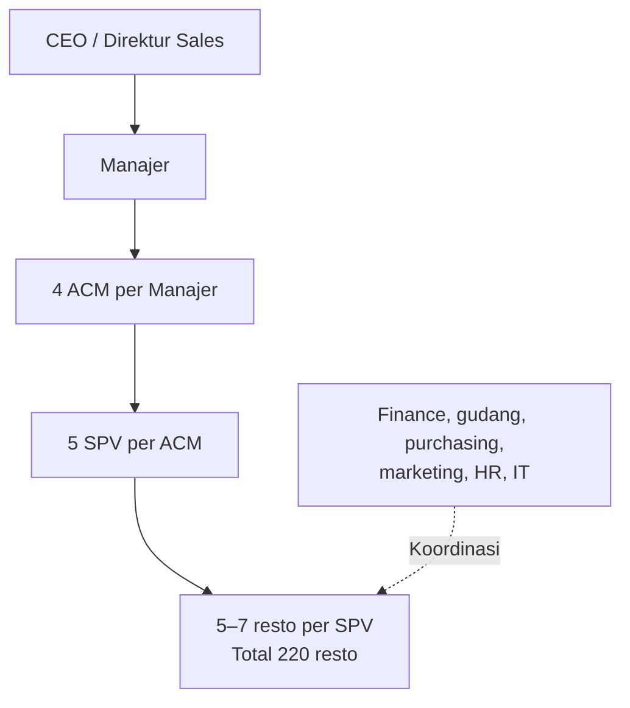
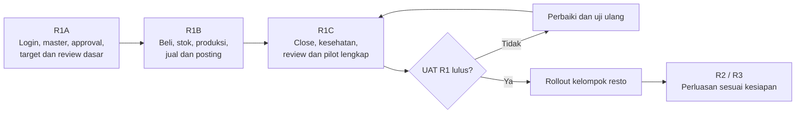
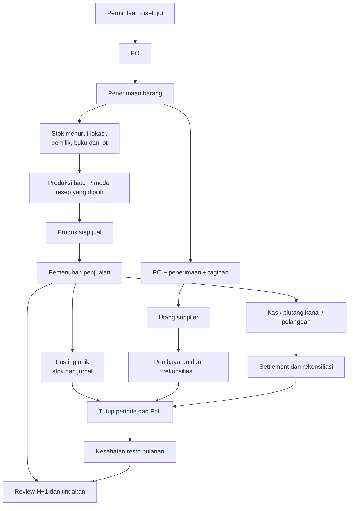
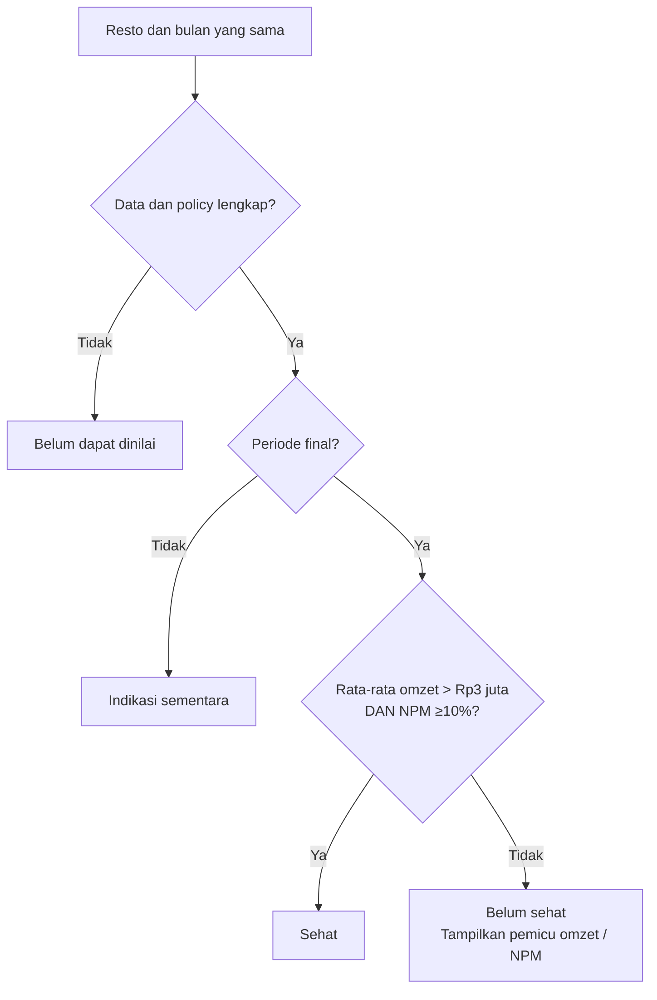
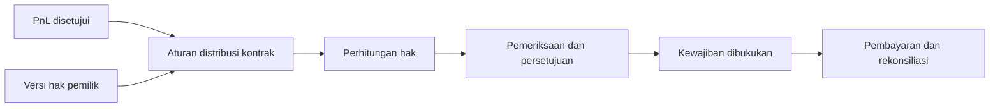
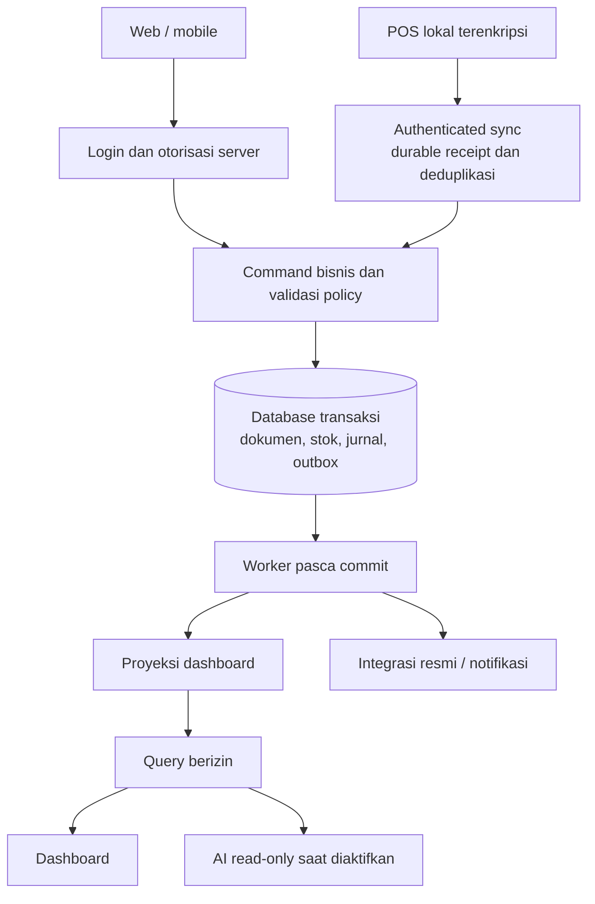
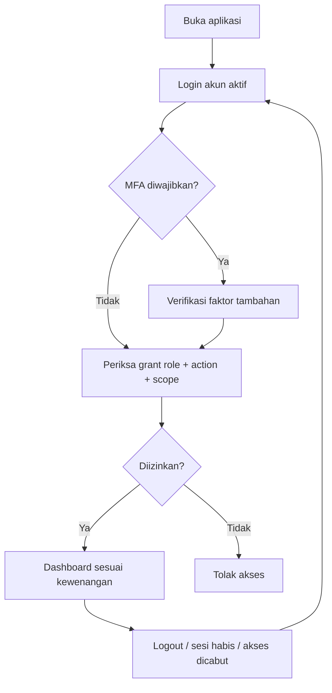

# ERP PT EBM d’Besto — Paket perencanaan v0.2

Tanggal: 1 November 2026. Review: Astra, dengan pemeriksaan terpisah atas operasi, finance/inventory, dan teknis. Status: baseline desain untuk review; belum ada implementasi aplikasi.

## 1. Kesimpulan review

v0.1 telah mencakup modul ERP utama, tetapi belum cukup tegas untuk langsung menjadi pegangan coding. Masalah terutama berada pada arti angka, perubahan status transaksi, kepemilikan barang/uang, dan kondisi pengecualian. v0.2 memperjelasnya melalui kontrak, contoh hitung, keputusan berversi, serta batas rilis.

Istilah **ERP standar** dalam paket ini berarti alur operasional dan pembukuan yang terhubung, kontrol persetujuan, jejak audit, rekonsiliasi, serta tanggung jawab yang jelas. Ini bukan klaim sertifikasi ERP atau bahwa satu desain berlaku untuk semua perusahaan.

Tidak mungkin menjamin seluruh kebingungan hilang sebelum validasi bisnis dan pengujian. Ukuran yang digunakan: setiap modul mempunyai aturan, pemilik keputusan, input/output, pengecualian, dan acceptance criteria sebelum coding dimulai.

### Panduan dokumen

| Dokumen normatif v0.2 | Otoritas isi |
|---|---|
| Dokumen utama ini | Fakta bisnis, cakupan, rilis, prioritas, status keputusan |
| [Operasional dan UAT](ERP-EBM-v0.2-Operasional-dan-UAT.md) | Target, review, kesehatan, sampling, tindakan dan penerimaan operasi |
| [KPI dan akuntansi](ERP-EBM-v0.2-KPI-dan-Akuntansi.md) | Formula, arus biaya/stok, posting, contoh numerik |
| [Kontrak teknis](ERP-EBM-v0.2-Kontrak-Teknis.md) | Akses, API, data, state, transaksi bersamaan dan offline |

Diagram menjelaskan aturan teks; tidak menciptakan kebijakan tambahan. Jika ditemukan konflik, catat issue dan perbaiki sumber beserta contoh ujinya sebelum ticket siap dikerjakan. Jangan menafsirkan dokumen lama sebagai alternatif aturan.

### Status persyaratan

| Label | Arti | Boleh digunakan untuk apa? |
|---|---|---|
| CONFIRMED | Dinyatakan pengguna | Aturan bisnis dalam spesifikasi |
| DESIGN | Pilihan rancangan yang direkomendasikan | Desain/prototype dan simulasi; bukan persetujuan operasional |
| GATED | Kebijakan material belum disahkan | Bangun struktur generik setelah izin coding; aktivasi nyata ditolak sampai disahkan |
| DEFERRED | Fitur pada rilis berikutnya | Tidak menjadi syarat rilis sebelumnya jika benar-benar nonaktif |

Profil contoh dalam lampiran bersifat DESIGN. Konfigurasi produksi harus eksplisit dan disetujui; tidak otomatis mengambil nilai contoh ketika konfigurasi kosong.

## 2. BRD — dasar dan hasil bisnis

### 2.1 Ketentuan CONFIRMED

| ID | Ketentuan |
|---|---|
| B01 | 220 resto seluruhnya dikelola PT EBM dengan model titip kelola. |
| B02 | Gudang pusat dan gudang area mendukung jaringan. |
| B03 | SPV membawahi 5–7 resto; ACM membawahi 5 SPV; Manajer membawahi 4 ACM. |
| B04 | CEO sebagai Direktur Sales menetapkan target omzet berbeda per resto. |
| B05 | TC adalah jumlah struk; target >100 per hari. Bukan pelanggan unik. |
| B06 | APC >Rp30.000; COGS bahan pembentuk produk jual <70%. |
| B07 | Sehat: rata-rata omzet harian bulanan >Rp3 juta DAN NPM bulan yang sama ≥10%. |
| B08 | SPV mereview semua resto bawahannya pada H+1 sebelum pukul 12.00. |
| B09 | ACM mereview SPV dan sampling langsung ke resto; frekuensi sampling belum ditetapkan. |
| B10 | PnL disusun per resto; sistem dirancang dari nol tanpa bergantung format lama. |
| B11 | Bagi hasil mengikuti komposisi saham tiap resto; detail kontrak belum ditetapkan. |
| B12 | Seluruh fungsi tim dapat menggunakan aplikasi sesuai hak akses. |
| B13 | Login wajib sebelum dashboard; termasuk cakupan rilis pertama. |
| B14 | Pekerjaan saat ini perencanaan; coding memerlukan instruksi pengguna berikutnya. |

Rasio B03 menjadi pedoman kapasitas, bukan batas database yang membuat cluster sisa atau pengganti sementara tidak dapat dicatat. Penyimpangan penugasan membutuhkan alasan dan kewenangan.

### 2.2 Tujuan dan pemilik

| ID | Tujuan | Ukuran utama | Pemilik DESIGN |
|---|---|---|---|
| G01 | Disiplin menggunakan target | Tepat waktu, kelengkapan, mutu review; dilaporkan terpisah | Operasional |
| G02 | Tindakan menghasilkan perbaikan | Tepat waktu PIC, verifikasi, perubahan hasil | SPV/ACM |
| G03 | Resto sehat bertambah | Jumlah sehat dan jumlah belum dapat dinilai | CEO/Finance |
| G04 | Bahan terkendali | Stok, waste, selisih, stockout dan ketertelusuran | Supply chain |
| G05 | Angka dapat dipercaya | Kas/stock/subledger cocok buku besar; closing terkendali | Finance |
| G06 | Hak pemilik jelas | Perhitungan, persetujuan, pembayaran dan rekonsiliasi | Manajemen/Finance |
| G07 | Marketing terukur | Biaya, hasil teratribusi, repeat order, kontribusi | Marketing |

Target perbaikan dan baseline ditetapkan sebelum pilot. Login tidak dihitung sebagai review; menyelesaikan tugas tidak otomatis berarti KPI atau OKR tercapai.

### 2.3 Pemisahan yang wajib dipertahankan

- **Lokasi ≠ pemilik stok ≠ buku akuntansi ≠ badan hukum.** Model titip kelola harus dipetakan; 220 resto tidak otomatis menjadi 220 entitas hukum atau satu kepemilikan barang.
- **Penjualan jaringan ≠ pendapatan resmi PT EBM.** Laporan operasional diberi label; pengakuan pendapatan/konsolidasi menunggu kebijakan finance.
- **Pembelian ≠ pemakaian ≠ biaya produk terjual.** Barang dapat masih berada di gudang, proses, atau produk jadi.
- **Pemenuhan pesanan ≠ pembayaran ≠ settlement.** Status dan waktunya terpisah.
- **Target tercapai ≠ resto sehat.** Target harian berbeda dari kesehatan bulanan.
- **Historis penanggung jawab ≠ izin akses saat ini.** Histori tetap tersimpan ketika personel berpindah.

## 3. PRD — produk dan batas rilis

Beranda Saya menampilkan pekerjaan wajib, data kurang lengkap, persetujuan, dan tenggat. Menu/tombol mengikuti hak akses; semua permintaan tetap diperiksa server.

### 3.1 Peta modul dan kesiapan

| Modul | Rilis | Hasil minimum | Kesiapan saat ini |
|---|---|---|---|
| Login, akses, organisasi | R1A | Akun, sesi, penugasan, scope, audit | Kontrak inti tersedia; spesifikasi endpoint final dan pemulihan identitas sebelum coding |
| Master, approval, policy | R1A | Identitas, versi, satuan, kewenangan, aktivasi | Pola tersedia; pemetaan bisnis dan nilai konfigurasi GATED |
| Target/review/tindakan | R1A–R1C | Rutinitas H+1 dan pengawasan | Kontrak tersedia; kalender, ACM dan kebijakan target GATED |
| POS dan pembayaran | R1B | Cash sale, metode pembayaran terkontrol, refund, shift | Kontrak inti; perangkat, kanal dan kebijakan finansial GATED |
| Purchasing/gudang | R1B | PO, penerimaan, transfer, opname, tagihan | Kontrak inti; owner/book, valuasi, toleransi GATED |
| Resep/produksi | R1B | Batch, konsumsi, yield, waste, finished goods | Kontrak inti; master resep nyata dan mode item GATED |
| Accounting dasar | R1B–R1C | GL, kas/bank, AP/AR dasar, PnL, neraca saldo, close | Matriks posting contoh; kebijakan resmi GATED |
| Sampling/operasi dasar | R1C | Kunjungan, temuan, tindakan, checklist kritis | Kontrak pilot; SOP/frekuensi GATED |
| Bagi hasil | R2 | Hak pemilik sampai pembayaran | DEFERRED; kontrak saham dan distribusi GATED |
| Aset/maintenance/audit lanjutan | R2 | Siklus aset dan corrective maintenance | DEFERRED; detail FRD per fungsi sebelum coding |
| Marketing/CRM/group order | R2 | Campaign, voucher, consent, pipeline, atribusi | DEFERRED; event dan aturan promo perlu kontrak tersendiri |
| People/OKR | R2 | Personel, shift, training, kompetensi, KR | DEFERRED; payroll tidak termasuk HR dasar |
| AI read-only | R2 opsional | Ringkasan dan query berizin | DEFERRED; harus lulus evaluasi sumber/akses |
| Forecast/otomatisasi | R3 | Prediksi, replenishment, rekomendasi | DEFERRED; baseline dan evaluasi manfaat wajib |
| Payroll/pajak otomatis | Subproyek | Kebutuhan khusus yang disahkan | Belum dijadwalkan; bukan fitur yang diasumsikan selesai |

R1A boleh diuji dengan fixture fiktif yang dilabeli demo. Go-live operasional R1 mensyaratkan transaksi, rekonsiliasi dan review lengkap, bukan sekadar dashboard dengan angka manual yang dianggap aktual.

### 3.2 Pekerjaan utama per pengguna

| Peran | Masuk dashboard untuk… | Data sensitif tidak otomatis diberikan |
|---|---|---|
| CEO | Target, kesehatan, prioritas jaringan | Akses khusus tetap harus diberikan eksplisit |
| Manajer/ACM | Review bawahan, hambatan, sampling | PII HR, rekening pemilik, semua jurnal |
| SPV | Review seluruh resto, tindakan, verifikasi | Resto di luar scope aktif |
| PIC/kasir | Operasional, penjualan, kas, stok yang diizinkan | PnL penuh/komposisi saham tanpa grant |
| Gudang/purchasing | Ketersediaan, permintaan, PO, pengiriman | Pembayaran atau perubahan rekening tanpa izin |
| Finance | Rekonsiliasi, posting, close, kewajiban | Approve sendiri hanya karena punya banyak peran tetap ditolak |
| Marketing/HR | Fungsi masing-masing | Data lintas fungsi yang tidak diperlukan |
| Admin | Kelola akun/perangkat | Tidak otomatis menjadi pejabat persetujuan bisnis |

### 3.3 Kontrol khas restoran fried chicken

- Satuan ekor, kg, potong dan paket tidak memakai konversi tetap tanpa dasar. Pemotongan menghasilkan yield aktual dan produk/potongan yang dapat ditelusuri.
- Resep dapat mencakup marinasi, tepung, minyak, saus, nasi, kemasan sesuai klasifikasi biaya yang disahkan. Penggantian bahan memiliki aturan dan versi.
- Barang beku, proses thawing, bahan antara, ayam matang dan produk tersisa memerlukan batch, waktu dan disposisi sesuai SOP. Batas suhu/masa simpan ditetapkan pemilik kualitas, tidak diciptakan developer.
- Produk matang yang direfund tidak otomatis menjadi stok layak jual.
- Lot karantina/recall diblokir; riwayat distribusi dan batch produksi menunjukkan lokasi terdampak. Pelaksanaan recall mengikuti pejabat berwenang.
- Checklist kritis dan jejak batch masuk R1; penjadwalan audit, maintenance dan scoring lanjutan R2.

## 4. FRD — aturan lintas modul

### 4.1 Semua fungsi menggunakan kontrak yang sama

Setiap fitur/ticket wajib mempunyai: ID, release, actor, scope, trigger, input wajib, precondition, source state, command, target state, efek stok/uang/audit, exception, retry, dan acceptance cases. API bebas mengubah kolom status dilarang.

| Kontrak | Aturan DESIGN |
|---|---|
| Dokumen berversi | Edit material setelah approval membatalkan approval; approver mengesahkan versi tertentu |
| Sumber angka | Setiap KPI menyimpan definition version, period, currency, scope, freshness, completeness, snapshot |
| Record posted | Tidak dihapus/ditimpa; correction/reversal memiliki referensi asal |
| Pengulangan perintah | Key sama + payload sama mengembalikan hasil pertama; payload berbeda konflik |
| Persetujuan bersamaan | Versi stale ditolak; hanya satu efek bisnis |
| Konfigurasi kosong | Perintah terkait ditolak dengan kode kebijakan belum disetujui; tidak default ke nol |
| Tanggal | occurred_at, received_at, business_date, posting_date dan periode buku dipisah |
| Penutupan | Transaksi pending, gap perangkat, selisih tidak terselesaikan menghalangi final close menurut gate |
| Notifikasi | Gagal terkirim tidak mengubah fakta kewajiban; status tetap terlihat dalam aplikasi |
| Aktivasi fitur | Feature flag tidak menggantikan izin; gate rilis dan kebijakan diperiksa server |

### 4.2 Alur inti terhubung

Detail event→jurnal, penerimaan belum ditagih, uang muka, refund, produksi, transit, biaya kanal, serta pembagian laba berada pada lampiran finance. Diagram tidak berarti pembayaran harus menunggu penjualan pada semua jenis pesanan; deposit dan kredit memiliki alur tersendiri.

### 4.3 Kesehatan dan prioritas operasional

Prioritas review harian NORMAL/ATTENTION/URGENT (DESIGN) merupakan penentuan urutan kerja. Status tersebut tidak mengganti definisi kesehatan bulanan. Resto yang sehat bulan lalu tetap dapat memiliki insiden mendesak hari ini.

### 4.4 Bagi hasil

Keuntungan akuntansi, laba yang boleh dibagikan, dan kas tersedia adalah tiga ukuran berbeda. Perubahan saham tengah bulan tidak otomatis prorata. Fitur distribusi nonaktif sampai kontrak per resto dikonfigurasi dan disahkan.

## 5. TRD — keputusan desain

### 5.1 Fondasi yang direkomendasikan

Modular monolith dengan database relasional sebagai sumber transaksi. Domain memiliki kepemilikan data yang tegas. Penjualan, stok, dan posting dalam satu command bisnis dibuat konsisten menggunakan transaksi database; outbox menjalankan proyeksi, notifikasi, dan integrasi setelah commit.

Pemilihan PostgreSQL sebagai kandidat desain mendukung constraints dan transaksi, tetapi stack framework/cloud/versi belum ditetapkan. Unique constraints dan mekanisme concurrency harus benar-benar diterapkan, bukan hanya dicek di antarmuka. Prinsip ini merujuk [dokumentasi constraints PostgreSQL](https://www.postgresql.org/docs/current/ddl-constraints.html) dan [transaction isolation](https://www.postgresql.org/docs/current/transaction-iso.html).

### 5.2 Login, izin dan sesi

Login wajib; akun diprovision, tanpa pendaftaran publik. Hak diperiksa untuk aksi dan lokasi pada setiap permintaan, termasuk ekspor/download. Tidak ada akses hanya karena tombol disembunyikan. Dasarnya [OWASP Authorization](https://cheatsheetseries.owasp.org/cheatsheets/Authorization_Cheat_Sheet.html); detail parameter sesi dan uji ada pada kontrak teknis.

Gagal autentikasi tidak menghasilkan sesi. Riwayat role digunakan untuk attribution; akses saat ini mengikuti grant saat ini. Gabungan banyak role tidak boleh memperluas sebuah izin ke scope role lain secara otomatis.

### 5.3 Offline, close, dan koreksi

POS offline memerlukan perangkat terdaftar, izin offline terbatas, paket harga/resep, dan prosedur sinkronisasi. ACK sinkronisasi berarti server menyimpan bukti secara durable, bukan semua efek keuangan selesai. Transaksi valid tidak boleh dibuang akibat terlambat sinkron; masalah masuk antrean pengecualian.

Close mengunci periode serta memeriksa semua perangkat/shift dan posting. Late arrival untuk periode tertutup membutuhkan reopen atau adjustment yang disetujui; tidak menulis ulang PnL final secara diam-diam. Detil ada pada kontrak teknis dan finance.

### 5.4 Nonfunctional requirements DESIGN

| Area | Target usulan | Validasi sebelum go-live |
|---|---|---|
| Availability pusat | 99,9% bulanan | Definisi maintenance dan measurement |
| API umum | p95 ≤2 detik | Profil beban, data, perangkat, jaringan |
| Dashboard | p95 ≤5 detik | Query representatif, bukan cache kosong |
| POS lokal | p95 ≤1 detik operasi umum | Perangkat rujukan |
| Freshness | ≤5 menit setelah diterima server | Gap POS offline ditampilkan terpisah |
| Recovery pusat | RPO ≤15 menit, RTO ≤4 jam | Restore drill dan biaya disetujui |
| Skala | 220 resto | Perangkat, peak order/s, users, retention diketahui |

Angka ini tidak boleh disebut SLA yang sudah dijamin. Kebijakan retensi, penanganan data pribadi, pajak dan tenaga kerja diverifikasi sebelum modul terkait diaktifkan; dokumen ini tidak menetapkan tarif atau kewajiban hukum.

## 6. Daftar temuan audit dan penyelesaiannya

| ID | Temuan v0.1 | Perbaikan v0.2 | Status |
|---|---|---|---|
| A01 | TC/refund/APC dapat ditafsir berbeda | Profil perhitungan dan contoh refund lintas hari | DESIGN; kebijakan aktivasi GATED |
| A02 | Pemakaian, COGS dan waste tercampur | Bucket biaya terpisah; mapping target 70% eksplisit | DESIGN/GATED |
| A03 | Lokasi dianggap buku/pemilik | AccountingBook dan inventory owner terpisah | Kontrak; mapping nyata GATED |
| A04 | Produksi dan backflush dapat memotong dua kali | Mode berversi per item/lokasi dan effect unik | Kontrak |
| A05 | Tidak ada event→jurnal rinci | Matriks posting dan contoh numerik | Desain; akun/tax/recognition GATED |
| A06 | Zona pengguna menjadi zona bisnis | Zona resto wajib; contoh bukan default produksi | Kontrak |
| A07 | Submit, mutu, lengkap dan ACM tercampur | Status independen; snapshot review immutable | Kontrak |
| A08 | Perpindahan SPV ambigu | Owner historis, assignee sekarang, grant sekarang terpisah | Kontrak |
| A09 | Timeout/idempotency/concurrency umum saja | Payload conflict, expected_version, revocation, retry | Kontrak |
| A10 | ACK disamakan transaksi selesai | Receipt vs posting; exception dan close gate | Kontrak |
| A11 | Bagi hasil/AI menghambat R1 | UAT sesuai release/fitur aktif | Diperbaiki |
| A12 | Semua modul dianggap siap coding | Definition of Ready dan daftar kontrak lanjutan | Diperbaiki |

## 7. Keputusan bisnis dan mekanisme gate

Developer tidak bertugas memilih kebijakan finansial atau kontrak. Setiap policy: ID, versi, status DRAFT/APPROVED/RETIRED, scope, tanggal berlaku, payload, approver, waktu persetujuan. Tidak boleh ada dua policy berlaku tumpang tindih pada scope dan jenis yang sama. Perintah menolak konfigurasi hilang dengan error yang dapat ditindaklanjuti.

| ID | Keputusan dan rekomendasi desain | Pemilik | Jika belum disahkan |
|---|---|---|---|
| D01 | Net sales sebelum komisi, TC struk dipenuhi, refund by posting date; lihat contoh lampiran | CEO/Finance | KPI resmi/POS produksi tidak aktif |
| D02 | Zona resto, cutoff; rekomendasi denominator hari kalender aktif | CEO/Operasi | Kewajiban/jadwal dan kesehatan final belum diaktifkan |
| D03 | Target harian authoritative; pembagian bulanan draft berbobot | CEO | Tampil target belum ditetapkan, tidak menilai gagal |
| D04 | Tenggat ACM, delegasi, eskalasi dan exception | Operasi | Workflow dapat disimulasikan; SLA produksi belum dinilai |
| D05 | Sampling 2 resto unik/minggu sebagai pilot usulan | Operasi | Tidak memberi label pelanggaran sampling |
| D06 | PIC dan penempatan nyata | Operasi/HR | Outlet tanpa PIC tidak masuk rollout |
| D07 | Resep/yield/satuan/mode produksi | Supply/Operasi | Item terkait tidak diaktifkan |
| D08 | Valuasi, cost pool, bucket KPI 70%, waste/overhead/alokasi | Finance/CEO | Costing final dan penilaian 70% diblokir |
| D09 | Owner/book/entitas, pajak, akun, pengakuan dan konsolidasi | Finance/Manajemen | Posting produksi/laporan resmi diblokir |
| D10 | Hak pemilik, laba dibagi, cadangan, perubahan saham | Manajemen/Finance | Modul distribusi nonaktif |
| D11 | Limit persetujuan, maker/checker, rekening, recovery admin | CEO/pemilik fungsi | Approval sensitif ditolak; tidak default unlimited |
| D12 | Perangkat, metode pembayaran, offline lease dan limit | Operasi/IT | Offline/digital connector tidak diaktifkan |
| D13 | Beban, SLA, recovery, retensi dan dukungan | IT/Bisnis | Tidak lolos go-live |
| D14 | Closing, late arrival, reopen dan adjustment | Finance | Final close belum aktif |
| D15 | Consent, SOP pangan, kebutuhan HR/pajak | Pemilik fungsi | Fungsi terkait tidak diaktifkan |
| D16 | Budget, tim, pilot, jadwal dan sign-off | Sponsor | Tidak ada komitmen jadwal/biaya |

## 8. Definition of Ready sebelum coding per modul

Sebuah modul/ticket berstatus READY hanya jika:

1. Tujuan, release dan batas cakupan jelas, beserta requirement ID.
2. Semua aturan yang memengaruhi perilaku ticket diputuskan; policy produksi yang belum sah dibatasi eksplisit ke simulasi/engine generik.
3. State/actor/guard/side-effect dan pembatalan/kompensasi lengkap.
4. Data dictionary, relasi, constraint, index dan migration detail tersedia untuk perubahan tersebut.
5. API schema/OpenAPI lengkap berikut error, pagination, versioning, retry dan permission.
6. Contoh input/output, kasus batas, concurrency dan reconciliation dapat diuji.
7. UI wireframe untuk aksi kritis dan empty/error/loading/offline state direview.
8. Pemilik penerimaan, dependency, rollback dan observability ditetapkan.

Kontrak lampiran mempersempit interpretasi, tetapi belum menggantikan OpenAPI lengkap, DDL final, atau wireframe semua modul. Ketiganya adalah deliverable per ticket, bukan tugas yang boleh dilewatkan dengan menebak.

### Status kesiapan saat versi ini terbit

- BRD/PRD: siap review sponsor dan pemilik fungsi.
- Kontrak inti operasi, finance dan teknis: siap untuk validasi dan penurunan ticket.
- Implementasi menyeluruh 220 resto: belum READY; gate bisnis, spesifikasi per modul, perangkat, dan UAT masih diperlukan.
- Tidak ada kode aplikasi atau provisioning yang dilakukan dalam review ini.

## 9. Penerimaan, pilot dan rollout

Pilot DESIGN: 5–7 resto satu SPV, melibatkan ACM, finance, purchasing, gudang yang relevan. Kondisi koneksi dan kesehatan bervariasi. Pilot harus melewati satu penutupan bulanan; tanggal dan durasi disepakati setelah kapasitas tim jelas.

| Gate | Wajib diuji | Tidak wajib bila fitur nonaktif |
|---|---|---|
| R1A | Login, scope, versi, assignment, review fixture, approval, audit | Transaksi produksi belum dinyatakan go-live |
| R1 operasional | Semua core POS/supply/accounting/review, offline, restore, close, akses | Distribusi R2, CRM R2, AI |
| R2 | Uji domain yang diaktifkan plus regression core | Domain R2 lain yang belum aktif dan R3 |
| AI | Sumber, akses retrieval, akurasi angka, injection, audit, evaluasi | Tidak boleh dianggap lolos hanya karena login core lolos |

Kriteria: tidak ada defect kritis kehilangan data, akses, atau nilai uang terbuka; transaksi dapat direkonsiliasi; selisih dijelaskan sesuai toleransi; kebijakan aktif dan saldo awal disetujui; pengguna lulus simulasi; runbook/restore/cutover diuji. Approval go-live tidak digantikan oleh hitungan jumlah test.

Pembukaan saldo melalui pendataan/opname baru: lokasi, stok/lot, kas/bank, utang/piutang, aset, modal dan hak pemilik. Tidak perlu memakai sistem lama, tetapi saldo tidak boleh dianggap nol hanya karena tidak diimpor.

Rollback setelah transaksi nyata tidak berarti memulihkan backup lama lalu membuang transaksi baru. Bekukan rollout, pertahankan bukti transaksi, lakukan forward fix atau cutback terkontrol dengan rekonsiliasi sesuai runbook.

## 10. Referensi dan batas penerapan

### 10.1 Ketertelusuran dan hasil pemeriksaan dokumen

| Kebutuhan | Kontrak utama | Skenario penerimaan |
|---|---|---|
| Login dan akses per scope | Teknis AT01–AT03 dan sesi | T01–T04, T13; O09, O30–O31 |
| Target berversi | Operasional bagian 7 | O16–O20 |
| Review H+1 | Operasional bagian 2–5 | O01–O15; T05 |
| Kesehatan bulanan | Operasional bagian 8; Finance MET-06–08 | O21–O25 |
| Sampling dan tindakan | Operasional bagian 9–10 | O26–O29, O32 |
| Penjualan dan refund | Finance bagian 2 dan 6 | ACC-01–04, ACC-12–13 |
| Stok, produksi, pembelian | Finance bagian 3–6 | ACC-05–09, ACC-11, ACC-14 |
| Offline, retry dan close | Teknis bagian 6–8; Finance bagian 7 | T06–T12 |
| Bagi hasil R2 | Finance bagian 7 | ACC-10, T14; O34 menguji pemisahan rilis |
| OKR R2 / AI saat aktif | Kontrak perluasan sebelum coding | O33, O35, T15; bukan uji fitur lengkap R2/R3 |

Pemeriksaan dokumen pada 1 November 2026: 68 skenario penerimaan tercatat (39 operasi, 14 finance, 15 teknis), tanpa ID ganda pada masing-masing lampiran; tautan lokal diperiksa; sembilan contoh hitung utama direkalkulasi dan cocok. Paket v0.2 memiliki sembilan diagram Mermaid dengan penutup blok yang lengkap. Tampilan render diagram belum diuji pada seluruh pembaca Markdown.

Angka tersebut adalah verifikasi dokumen dan aritmetika. Skenario penerimaan aplikasi belum dijalankan karena aplikasinya belum dibangun. Kasus tambahan dan OpenAPI/DDL per ticket tetap wajib untuk modul yang belum rinci.

### 10.2 Sumber primer

Paket mengacu pada pola ERP dan kontrol teknis dari sumber primer berikut, bukan menyalin seluruh produk atau mengklaim kepatuhan PT EBM:

- Pencocokan PO–penerimaan–tagihan: [Microsoft Dynamics 365 three-way matching](https://learn.microsoft.com/en-us/dynamics365/finance/accounts-payable/three-way-matching-policies).
- Pemisahan nilai persediaan dan pengakuan beban saat penjualan: [IFRS IAS 2](https://www.ifrs.org/issued-standards/list-of-standards/ias-2-inventories/). Kebijakan akuntansi yang berlaku pada PT EBM harus ditentukan finance; referensi ini bukan penetapan standar pelaporan lokal.
- Kontrol akses dan sesi: [OWASP Authorization](https://cheatsheetseries.owasp.org/cheatsheets/Authorization_Cheat_Sheet.html), [OWASP Session Management](https://cheatsheetseries.owasp.org/cheatsheets/Session_Management_Cheat_Sheet.html).
- Integritas dan concurrency: [PostgreSQL constraints](https://www.postgresql.org/docs/current/ddl-constraints.html), [transaction isolation](https://www.postgresql.org/docs/current/transaction-iso.html).

Keputusan proyek, angka contoh, urutan rilis dan desain policy merupakan hasil rancangan untuk PT EBM, bukan rekomendasi yang dikutip dari sumber tersebut.
